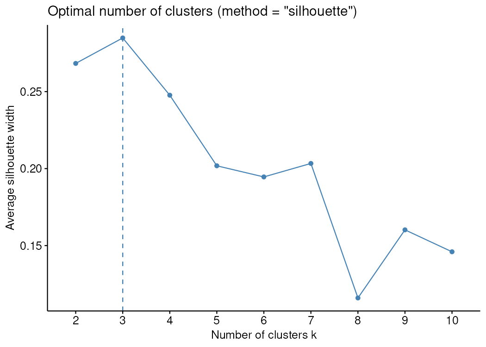
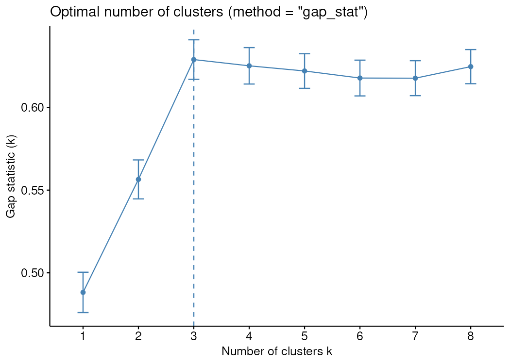
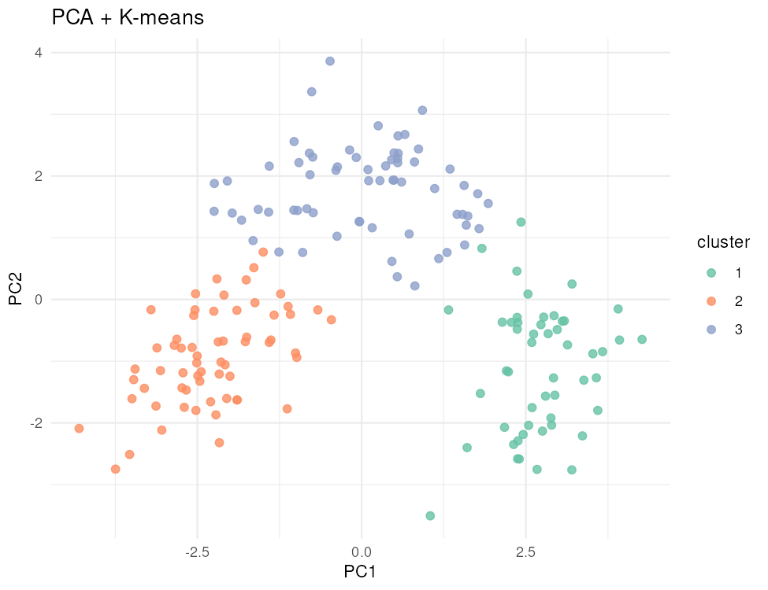
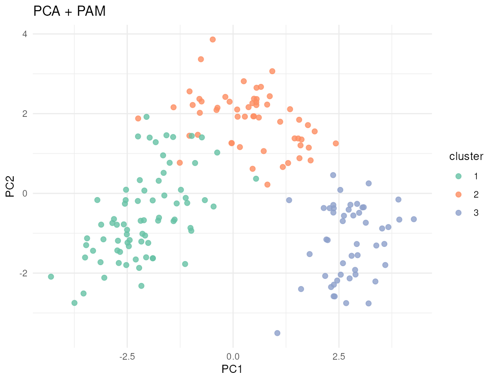
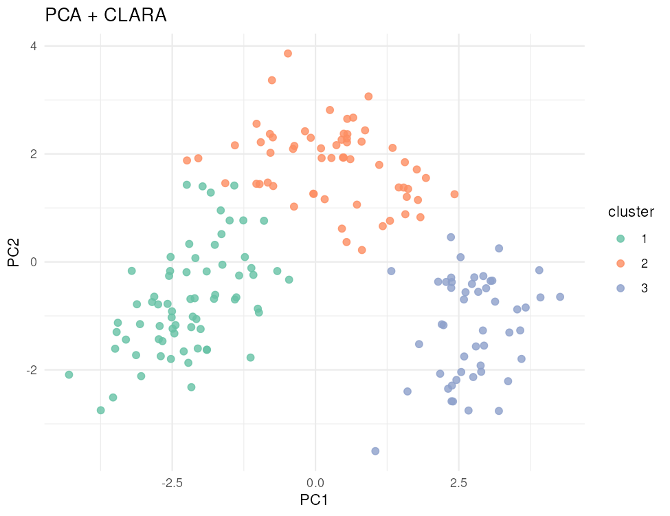
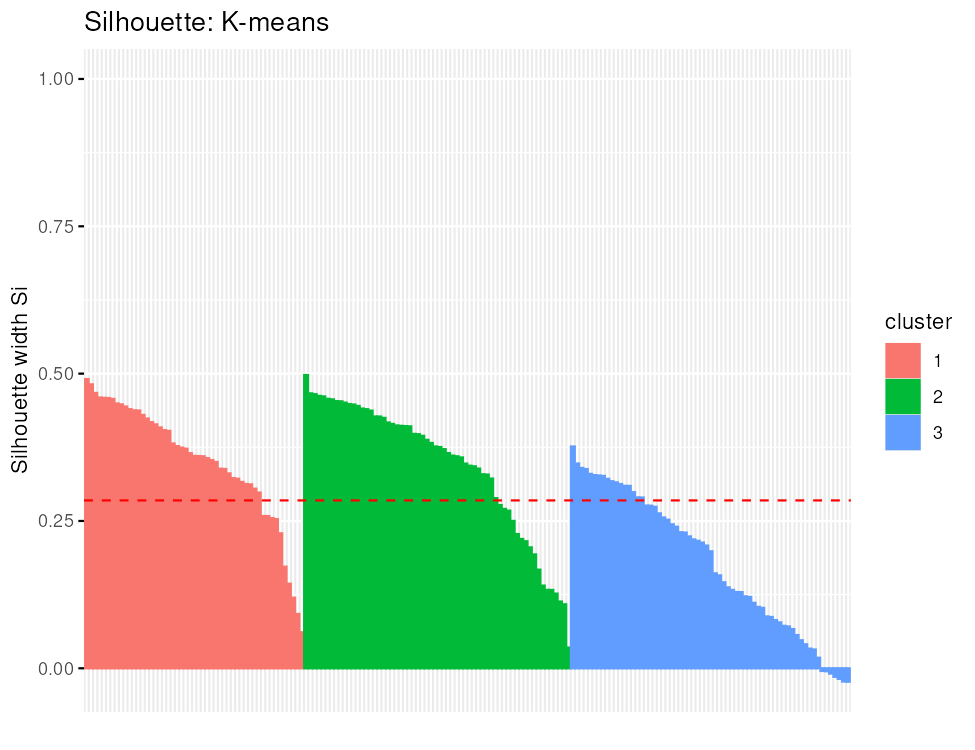
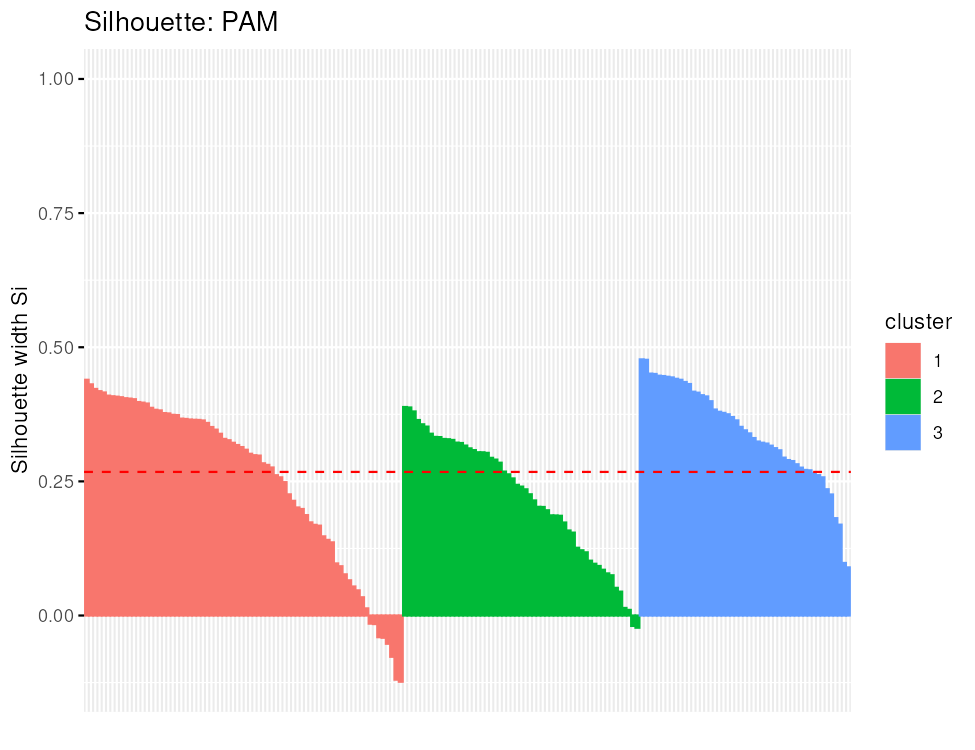
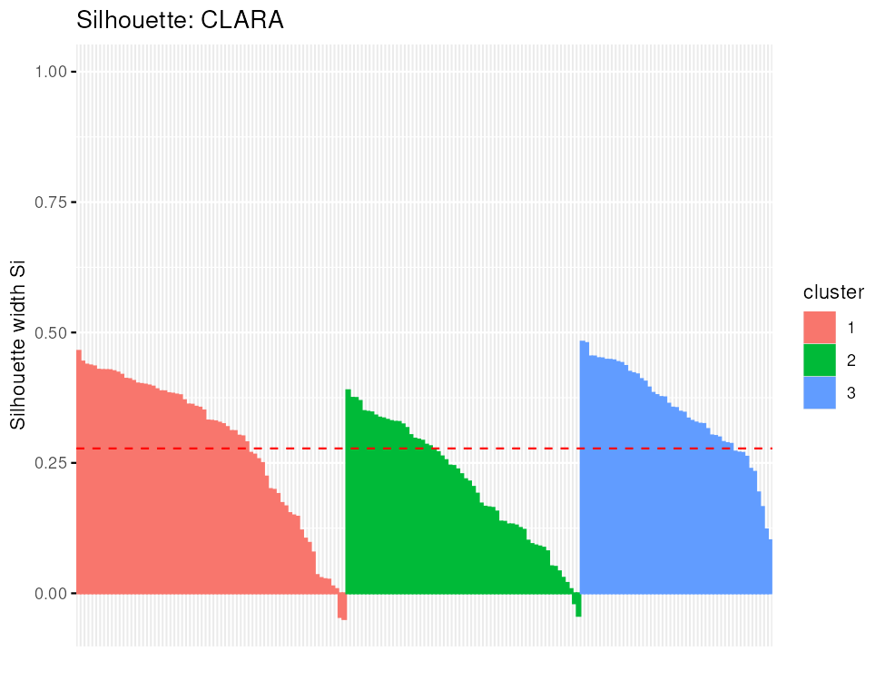

# Отчёт по лабораторной работе № 2. Задача 1

Дисциплина: «Продвинутые технологии работы с большими данными». Обучающийся: Шатов Илья Андреевич. Группа: ВБИо-403-рсоб. Преподаватель: поле для подписи.

Графики скрипта: `task1_nbclust_silhouette.png`, `task1_gap_stat.png`, `task1_pca_kmeans.png`, `task1_pca_pam.png`, `task1_pca_clara.png`, `task1_silhouette_kmeans.png`, `task1_silhouette_pam.png`, `task1_silhouette_clara.png`.

# ВВЕДЕНИЕ

**Условие.** Провести кластерный анализ набора данных Wine и сравнить
эффективность трёх алгоритмов: K-means, PAM и CLARA. Нужно подготовить
признаки и истинные классы, стандартизировать данные, выбрать число
кластеров методом силуэта и статистикой разрыва, выполнить кластеризацию
при k = 3, показать кластеры в пространстве двух главных компонент,
построить графики силуэтов и сравнить разбиения с истинными классами по
скорректированному индексу Рэнда (ARI).

**Цель работы** — определить, какой из трёх алгоритмов лучше
восстанавливает известные типы вин, и обосновать выбор по графикам и по
ARI.

# 1 Подготовка данных Wine

Набор содержит результаты химического анализа вин трёх типов. Первый
столбец — истинный класс (`Type`), остальные 13 столбцов — признаки
(спирт, яблочная кислота, зола, щёлочность золы, магний, фенолы,
флавоноиды, нефлавоноидные фенолы, проантоцианины, интенсивность цвета,
оттенок, оптическая плотность разбавленного вина, пролин). Признаки
измерены в разных шкалах, поэтому перед кластеризацией их
стандартизируют.

    pkgs <- c("tidyverse", "cluster", "factoextra", "patchwork", "RColorBrewer",
              "mclust", "caret", "rattle")
    new <- pkgs[!pkgs %in% installed.packages()[, "Package"]]
    if (length(new) > 0) install.packages(new)

    library(tidyverse)
    library(cluster)
    library(factoextra)
    library(patchwork)
    library(RColorBrewer)
    library(mclust)
    library(caret)
    library(rattle)
    library(dplyr)

    items <- tryCatch(
      data(package = "rattle")$results[, "Item"],
      error = function(e) character()
    )
    if ("wine" %in% items) {
      data("wine", package = "rattle")
    } else {
      cache_file <- if (file.exists("../../data/wine.csv")) {
        "../../data/wine.csv"
      } else {
        "data/wine.csv"
      }
      if (!file.exists(cache_file)) {
        stop("В пакете rattle нет набора wine и кэш data/wine.csv не найден")
      }
      wine <- read.csv(cache_file)
      wine$Type <- factor(wine$Type)
    }
    head(wine)

    ##   Type Alcohol Malic  Ash Alcalinity Magnesium Phenols Flavanoids Nonflavanoids
    ## 1    1   14.23  1.71 2.43       15.6       127    2.80       3.06          0.28
    ## 2    1   13.20  1.78 2.14       11.2       100    2.65       2.76          0.26
    ## 3    1   13.16  2.36 2.67       18.6       101    2.80       3.24          0.30
    ## 4    1   14.37  1.95 2.50       16.8       113    3.85       3.49          0.24
    ## 5    1   13.24  2.59 2.87       21.0       118    2.80       2.69          0.39
    ## 6    1   14.20  1.76 2.45       15.2       112    3.27       3.39          0.34
    ##   Proanthocyanins Color  Hue Dilution Proline
    ## 1            2.29  5.64 1.04     3.92    1065
    ## 2            1.28  4.38 1.05     3.40    1050
    ## 3            2.81  5.68 1.03     3.17    1185
    ## 4            2.18  7.80 0.86     3.45    1480
    ## 5            1.82  4.32 1.04     2.93     735
    ## 6            1.97  6.75 1.05     2.85    1450

    str(wine)

    ## 'data.frame':    178 obs. of  14 variables:
    ##  $ Type           : Factor w/ 3 levels "1","2","3": 1 1 1 1 1 1 1 1 1 1 ...
    ##  $ Alcohol        : num  14.2 13.2 13.2 14.4 13.2 ...
    ##  $ Malic          : num  1.71 1.78 2.36 1.95 2.59 1.76 1.87 2.15 1.64 1.35 ...
    ##  $ Ash            : num  2.43 2.14 2.67 2.5 2.87 2.45 2.45 2.61 2.17 2.27 ...
    ##  $ Alcalinity     : num  15.6 11.2 18.6 16.8 21 15.2 14.6 17.6 14 16 ...
    ##  $ Magnesium      : int  127 100 101 113 118 112 96 121 97 98 ...
    ##  $ Phenols        : num  2.8 2.65 2.8 3.85 2.8 3.27 2.5 2.6 2.8 2.98 ...
    ##  $ Flavanoids     : num  3.06 2.76 3.24 3.49 2.69 3.39 2.52 2.51 2.98 3.15 ...
    ##  $ Nonflavanoids  : num  0.28 0.26 0.3 0.24 0.39 0.34 0.3 0.31 0.29 0.22 ...
    ##  $ Proanthocyanins: num  2.29 1.28 2.81 2.18 1.82 1.97 1.98 1.25 1.98 1.85 ...
    ##  $ Color          : num  5.64 4.38 5.68 7.8 4.32 6.75 5.25 5.05 5.2 7.22 ...
    ##  $ Hue            : num  1.04 1.05 1.03 0.86 1.04 1.05 1.02 1.06 1.08 1.01 ...
    ##  $ Dilution       : num  3.92 3.4 3.17 3.45 2.93 2.85 3.58 3.58 2.85 3.55 ...
    ##  $ Proline        : int  1065 1050 1185 1480 735 1450 1290 1295 1045 1045 ...

    df <- wine[, -1]
    df_scaled <- scale(df)
    true_class <- wine$Type
    n_na <- sum(is.na(df))
    n_na

    ## [1] 0

    table(true_class)

    ## true_class
    ##  1  2  3 
    ## 59 71 48

Пропусков в матрице признаков — 0. Всего 178 вин и 13 признаков.
Истинных классов — 3, их частоты: 1 — 59; 2 — 71; 3 — 48.

**Вывод.** Данные полные и пригодны для кластеризации. Класс `Type`
отделён от признаков и используется только как внешний критерий (ARI), а
не как вход алгоритма. Стандартизация `scale()` выравнивает вклад
пролина и магния с вкладом оттенка и фенолов.

# 2 Выбор числа кластеров

Число кластеров оценивается двумя способами при одном зерне датчика
случайных чисел. По условию практикума само разбиение выполняется при k
= 3 — по числу известных типов вина.

    k <- 3
    pal <- brewer.pal(8, "Set2")

    set.seed(123)
    p_sil <- fviz_nbclust(df_scaled, kmeans, method = "silhouette")
    gap_stat <- clusGap(df_scaled, FUN = kmeans, nstart = 25,
                        K.max = 8, B = 50)
    p_gap <- fviz_gap_stat(gap_stat)

    sil_df <- as.data.frame(p_sil$data)
    k_sil <- as.integer(as.character(sil_df$clusters[which.max(sil_df$y)]))
    k_gap <- as.integer(maxSE(gap_stat$Tab[, "gap"], gap_stat$Tab[, "SE.sim"]))
    k_sil

    ## [1] 3

    k_gap

    ## [1] 3

Метод силуэта показан на рисунке 1, статистика разрыва — на рисунке 2.

<figure>

<figcaption aria-hidden="true">Рисунок 1 — Выбор числа кластеров методом
силуэта</figcaption>
</figure>

<figure>

<figcaption aria-hidden="true">Рисунок 2 — Статистика разрыва (Gap
Statistic)</figcaption>
</figure>

**Интерпретация.** Максимум среднего силуэта достигается при k = 3.
Статистика разрыва (правило firstSEmax, им же пользуется
`fviz_gap_stat`) указывает на k = 3. Оба ориентира сопоставляются с
известным числом типов вина.

**Вывод.** Для сравнения с истинными классами далее фиксируется k = 3,
как требует задание. Если оценка по силуэту или по gap отличается от 3,
это означает, что внутренняя геометрия данных не обязана совпасть с
числом сортов, и качество при k = 3 нужно проверять отдельно — по
силуэтам разбиения и по ARI.

# 3 Кластеризация и сравнение алгоритмов

## 3.1 K-means, PAM и CLARA

K-means ищет сферические кластеры вокруг средних. PAM (partitioning
around medoids) опирается на реальные объекты-медоиды и устойчивее к
выбросам. CLARA строит PAM на подвыборках и предназначена для больших
наборов; здесь она применяется к тем же 178 винам, чтобы сравнить
алгоритмы на равных условиях.

    set.seed(123)
    km <- kmeans(df_scaled, centers = k, nstart = 25)
    pam_fit <- pam(df_scaled, k = k)
    clara_fit <- clara(df_scaled, k = k)

    table(Kmeans = km$cluster)

    ## Kmeans
    ##  1  2  3 
    ## 51 62 65

    table(PAM = pam_fit$clustering)

    ## PAM
    ##  1  2  3 
    ## 74 55 49

    table(CLARA = clara_fit$clustering)

    ## CLARA
    ##  1  2  3 
    ## 69 60 49

Размеры кластеров K-means: 51, 62, 65. PAM: 74, 55, 49. CLARA: 69, 60,
49. Частоты истинных классов — 59, 71, 48.

## 3.2 Проекция на главные компоненты

    pca <- prcomp(df_scaled)
    pca_df <- as.data.frame(pca$x[, 1:2])
    pca_imp <- summary(pca)$importance

    plot_pca <- function(clusters, title) {
      pca_df$cluster <- factor(clusters)
      ggplot(pca_df, aes(PC1, PC2, color = cluster)) +
        geom_point(size = 2, alpha = 0.8) +
        scale_color_manual(values = pal) +
        theme_minimal() +
        labs(title = title)
    }

Первые две компоненты объясняют 36.2 % и 19.2 % дисперсии (вместе 55.4
%). Это проекция для просмотра, а не само пространство кластеризации:
алгоритмы работали по всем 13 стандартизированным признакам.
Расположение кластеров показано на рисунках 3–5.

    plot_pca(km$cluster, "PCA + K-means")

<figure>

<figcaption aria-hidden="true">Рисунок 3 — Кластеры K-means в
пространстве двух главных компонент</figcaption>
</figure>

    plot_pca(pam_fit$clustering, "PCA + PAM")

<figure>

<figcaption aria-hidden="true">Рисунок 4 — Кластеры PAM в пространстве
двух главных компонент</figcaption>
</figure>

    plot_pca(clara_fit$clustering, "PCA + CLARA")

<figure>

<figcaption aria-hidden="true">Рисунок 5 — Кластеры CLARA в пространстве
двух главных компонент</figcaption>
</figure>

**Вывод.** На рисунках 3–5 три группы вин разделяются вдоль PC1, но
границы не пустые: часть объектов лежит между облаками. Картины K-means,
PAM и CLARA близки, значит различия алгоритмов на этих данных невелики и
их нужно подтверждать числами, а не только проекцией.

## 3.3 Графики силуэтов

Средняя ширина силуэта показывает, насколько объект ближе к своему
кластеру, чем к соседнему. Графики — на рисунках 6–8.

    sil_width <- function(clusters) {
      mean(silhouette(clusters, dist(df_scaled))[, "sil_width"])
    }
    sil_km <- sil_width(km$cluster)
    sil_pam <- sil_width(pam_fit$clustering)
    sil_clara <- sil_width(clara_fit$clustering)
    c(Kmeans = sil_km, PAM = sil_pam, CLARA = sil_clara)

    ##    Kmeans       PAM     CLARA 
    ## 0.2848589 0.2676221 0.2777125

    fviz_silhouette(silhouette(km$cluster, dist(df_scaled))) +
      ggtitle("Silhouette: K-means")

    ##   cluster size ave.sil.width
    ## 1       1   51          0.35
    ## 2       2   62          0.34
    ## 3       3   65          0.18

<figure>

<figcaption aria-hidden="true">Рисунок 6 — Силуэты кластеров
K-means</figcaption>
</figure>

    fviz_silhouette(silhouette(pam_fit$clustering, dist(df_scaled))) +
      ggtitle("Silhouette: PAM")

    ##   cluster size ave.sil.width
    ## 1       1   74          0.25
    ## 2       2   55          0.22
    ## 3       3   49          0.34

<figure>

<figcaption aria-hidden="true">Рисунок 7 — Силуэты кластеров
PAM</figcaption>
</figure>

    fviz_silhouette(silhouette(clara_fit$clustering, dist(df_scaled))) +
      ggtitle("Silhouette: CLARA")

    ##   cluster size ave.sil.width
    ## 1       1   69          0.29
    ## 2       2   60          0.21
    ## 3       3   49          0.35

<figure>

<figcaption aria-hidden="true">Рисунок 8 — Силуэты кластеров
CLARA</figcaption>
</figure>

**Интерпретация.** Средний силуэт K-means равен 0.285, PAM — 0.268,
CLARA — 0.278. Положительное среднее означает, что типичный объект
отнесён к более близкому кластеру; отдельные отрицательные полосы на
рисунках 6–8 — объекты на границе групп.

**Вывод.** Внутреннее качество трёх разбиений сопоставимо. Лидер по
среднему силуэту — алгоритм с наибольшим из трёх значений выше.

## 3.4 Сравнение с истинными классами

ARI равен 1 при полном совпадении разбиений с точностью до перестановки
меток и близок к 0, если совпадение не лучше случайного.

Таблица 1 — Качество кластеризации: ARI и средний силуэт

    ari_km <- adjustedRandIndex(km$cluster, true_class)
    ari_pam <- adjustedRandIndex(pam_fit$clustering, true_class)
    ari_clara <- adjustedRandIndex(clara_fit$clustering, true_class)

    ari_tbl <- data.frame(
      Алгоритм = c("K-means", "PAM", "CLARA"),
      ARI = c(ari_km, ari_pam, ari_clara),
      `Средний силуэт` = c(sil_km, sil_pam, sil_clara),
      check.names = FALSE
    )
    knitr::kable(ari_tbl, digits = 3)

<table>
<thead>
<tr>
<th style="text-align: left;">Алгоритм</th>
<th style="text-align: right;">ARI</th>
<th style="text-align: right;">Средний силуэт</th>
</tr>
</thead>
<tbody>
<tr>
<td style="text-align: left;">K-means</td>
<td style="text-align: right;">0.897</td>
<td style="text-align: right;">0.285</td>
</tr>
<tr>
<td style="text-align: left;">PAM</td>
<td style="text-align: right;">0.741</td>
<td style="text-align: right;">0.268</td>
</tr>
<tr>
<td style="text-align: left;">CLARA</td>
<td style="text-align: right;">0.814</td>
<td style="text-align: right;">0.278</td>
</tr>
</tbody>
</table>

    cat("K-means и истинные классы:\n")

    ## K-means и истинные классы:

    print(table(Истинный = true_class, Кластер = km$cluster))

    ##         Кластер
    ## Истинный  1  2  3
    ##        1  0 59  0
    ##        2  3  3 65
    ##        3 48  0  0

    cat("PAM и истинные классы:\n")

    ## PAM и истинные классы:

    print(table(Истинный = true_class, Кластер = pam_fit$clustering))

    ##         Кластер
    ## Истинный  1  2  3
    ##        1 59  0  0
    ##        2 15 55  1
    ##        3  0  0 48

    cat("CLARA и истинные классы:\n")

    ## CLARA и истинные классы:

    print(table(Истинный = true_class, Кластер = clara_fit$clustering))

    ##         Кластер
    ## Истинный  1  2  3
    ##        1 59  0  0
    ##        2 10 60  1
    ##        3  0  0 48

    ari_vec <- c(`K-means` = ari_km, PAM = ari_pam, CLARA = ari_clara)
    sil_vec <- c(`K-means` = sil_km, PAM = sil_pam, CLARA = sil_clara)
    best_ari_name <- names(which.max(ari_vec))
    best_sil_name <- names(which.max(sil_vec))
    best_ari <- max(ari_vec)
    best_sil <- max(sil_vec)

**Интерпретация.** По таблице 1 наибольший ARI у K-means (0.897),
наибольший средний силуэт у K-means (0.285). Оба критерия выделяют один
и тот же алгоритм — K-means. Таблицы сопряжённости показывают, что
каждый истинный класс в основном попадает в свой кластер, а ошибки
сосредоточены на границе двух соседних типов.

**Вывод.** Для этой задачи внешний критерий важнее: типы вин известны, и
цель — восстановить их. Предпочтительный алгоритм — K-means с ARI =
0.897.

# ВЫВОДЫ

На 178 образцах вина (13 стандартизированных признаков, пропусков — 0)
сравнены K-means, PAM и CLARA при k = 3. Метод силуэта дал оптимальное k
= 3, статистика разрыва — k = 3. В проекции PCA (рисунки 3–5) первые две
компоненты удерживают 55.4 % дисперсии и показывают три пересекающихся
облака.

По таблице 1 ARI составляет 0.897 (K-means), 0.741 (PAM) и 0.814
(CLARA); средние силуэты — 0.285, 0.268 и 0.278. Наиболее эффективен
K-means: он лучше совпадает с истинными классами и даёт самый высокий
средний силуэт. Ни один алгоритм не достигает ARI = 1: химические
профили соседних типов перекрываются, что видно и по отрицательным
силуэтам отдельных вин на рисунках 6–8.
