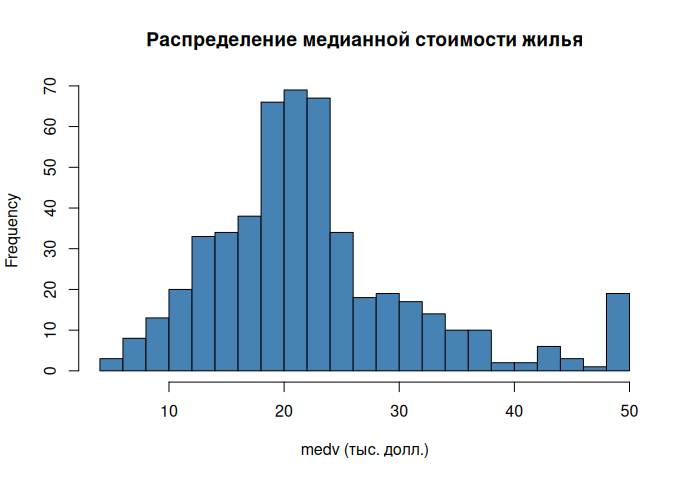
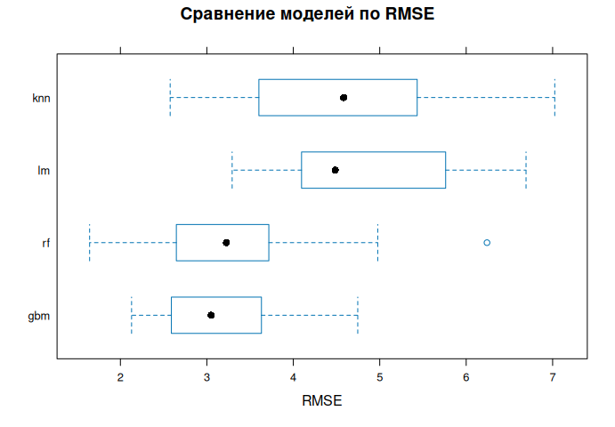
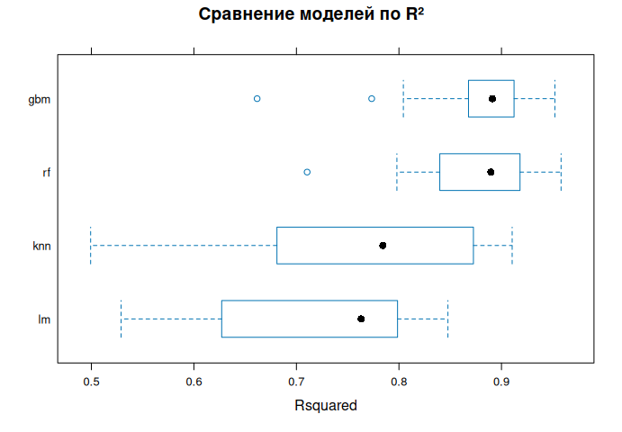
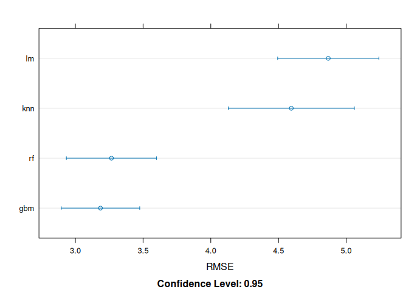
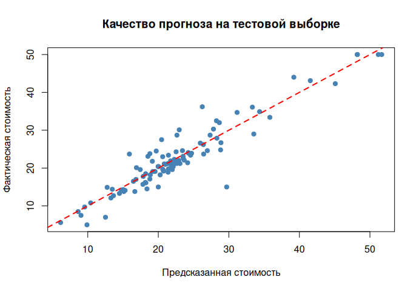
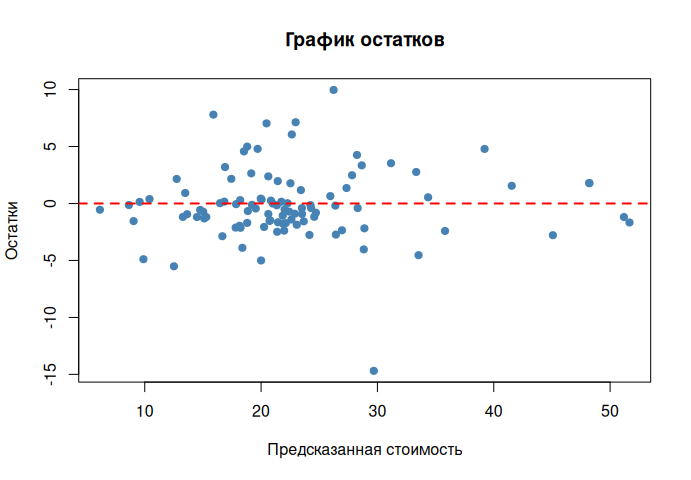
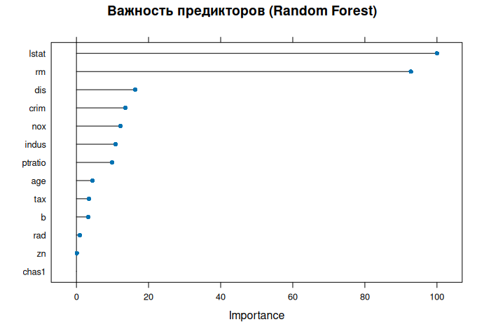
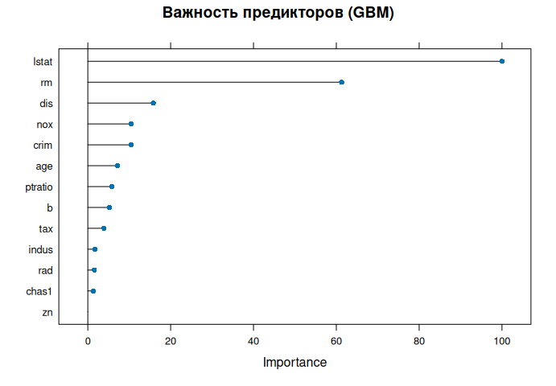
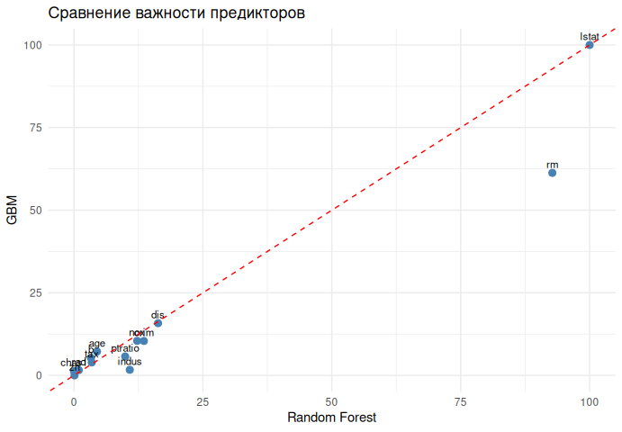

# Отчёт по лабораторной работе № 2. Задача 2

Дисциплина: «Продвинутые технологии работы с большими данными». Обучающийся: Шатов Илья Андреевич. Группа: ВБИо-403-рсоб. Преподаватель: поле для подписи.

Графики скрипта: `task2_medv_hist.png`, `task2_rmse_bwplot.png`, `task2_rsq_bwplot.png`, `task2_rmse_dotplot.png`, `task2_pred_vs_actual.png`, `task2_residuals.png`, `task2_varimp_rf.png`, `task2_varimp_gbm.png`, `task2_varimp_compare.png`.

# ВВЕДЕНИЕ

**Условие.** По набору BostonHousing построить модели прогноза медианной
стоимости жилья `medv` (тыс. долл.) по характеристикам района. Нужно
изучить структуру, пропуски, распределение цели и корреляции, разделить
данные на обучающую (80 %) и тестовую (20 %) выборки, обучить линейную
регрессию, k ближайших соседей, случайный лес и градиентный бустинг,
сравнить их повторной 10-кратной кросс-валидацией (3 повтора) по RMSE,
R² и MAE, выбрать модель с наименьшим RMSE, проверить её на тесте,
разобрать остатки и сравнить важность признаков у леса и бустинга.

**Цель работы** — выбрать модель с наименьшей ошибкой прогноза и назвать
характеристики жилья, которые сильнее всего связаны со стоимостью.

# 1 Подготовка и разведочный анализ

## 1.1 Структура данных и пропуски

Целевая переменная — `medv`. Предикторы: уровень преступности (`crim`),
доля участков большой площади (`zn`), доля неторговой застройки
(`indus`), граница с рекой Чарльз (`chas`), концентрация оксидов азота
(`nox`), среднее число комнат (`rm`), доля старого жилья (`age`),
удалённость от центров занятости (`dis`), доступность радиальных шоссе
(`rad`), ставка налога (`tax`), число учеников на учителя (`ptratio`),
преобразованная доля темнокожего населения (`b`) и доля населения с
низким статусом (`lstat`).

    pkgs <- c("caret", "mlbench", "randomForest", "gbm", "e1071", "ggplot2")
    new <- pkgs[!pkgs %in% installed.packages()[, "Package"]]
    if (length(new) > 0) install.packages(new)

    library(caret)
    library(mlbench)
    library(gbm)
    library(e1071)
    library(ggplot2)

    loaded <- tryCatch({
      data("BostonHousing", package = "mlbench")
      exists("BostonHousing") && is.data.frame(BostonHousing) &&
        nrow(BostonHousing) > 0 && "medv" %in% names(BostonHousing)
    }, error = function(e) FALSE)

    if (isTRUE(loaded)) {
      df <- BostonHousing
    } else {
      cache_file <- if (file.exists("../../data/boston.csv")) {
        "../../data/boston.csv"
      } else {
        "data/boston.csv"
      }
      if (!file.exists(cache_file)) {
        stop("Набор BostonHousing недоступен и кэш data/boston.csv не найден")
      }
      df <- read.csv(cache_file)
      df$chas <- factor(df$chas)
    }
    str(df)

    ## 'data.frame':    506 obs. of  14 variables:
    ##  $ crim   : num  0.00632 0.02731 0.02729 0.03237 0.06905 ...
    ##  $ zn     : num  18 0 0 0 0 0 12.5 12.5 12.5 12.5 ...
    ##  $ indus  : num  2.31 7.07 7.07 2.18 2.18 2.18 7.87 7.87 7.87 7.87 ...
    ##  $ chas   : Factor w/ 2 levels "0","1": 1 1 1 1 1 1 1 1 1 1 ...
    ##  $ nox    : num  0.538 0.469 0.469 0.458 0.458 0.458 0.524 0.524 0.524 0.524 ...
    ##  $ rm     : num  6.58 6.42 7.18 7 7.15 ...
    ##  $ age    : num  65.2 78.9 61.1 45.8 54.2 58.7 66.6 96.1 100 85.9 ...
    ##  $ dis    : num  4.09 4.97 4.97 6.06 6.06 ...
    ##  $ rad    : num  1 2 2 3 3 3 5 5 5 5 ...
    ##  $ tax    : num  296 242 242 222 222 222 311 311 311 311 ...
    ##  $ ptratio: num  15.3 17.8 17.8 18.7 18.7 18.7 15.2 15.2 15.2 15.2 ...
    ##  $ b      : num  397 397 393 395 397 ...
    ##  $ lstat  : num  4.98 9.14 4.03 2.94 5.33 ...
    ##  $ medv   : num  24 21.6 34.7 33.4 36.2 28.7 22.9 27.1 16.5 18.9 ...

    n_na <- sum(is.na(df))
    n_na

    ## [1] 0

    summary(df)

    ##       crim                zn             indus       chas         nox        
    ##  Min.   : 0.00632   Min.   :  0.00   Min.   : 0.46   0:471   Min.   :0.3850  
    ##  1st Qu.: 0.08205   1st Qu.:  0.00   1st Qu.: 5.19   1: 35   1st Qu.:0.4490  
    ##  Median : 0.25651   Median :  0.00   Median : 9.69           Median :0.5380  
    ##  Mean   : 3.61352   Mean   : 11.36   Mean   :11.14           Mean   :0.5547  
    ##  3rd Qu.: 3.67708   3rd Qu.: 12.50   3rd Qu.:18.10           3rd Qu.:0.6240  
    ##  Max.   :88.97620   Max.   :100.00   Max.   :27.74           Max.   :0.8710  
    ##        rm             age              dis              rad        
    ##  Min.   :3.561   Min.   :  2.90   Min.   : 1.130   Min.   : 1.000  
    ##  1st Qu.:5.886   1st Qu.: 45.02   1st Qu.: 2.100   1st Qu.: 4.000  
    ##  Median :6.208   Median : 77.50   Median : 3.207   Median : 5.000  
    ##  Mean   :6.285   Mean   : 68.57   Mean   : 3.795   Mean   : 9.549  
    ##  3rd Qu.:6.623   3rd Qu.: 94.08   3rd Qu.: 5.188   3rd Qu.:24.000  
    ##  Max.   :8.780   Max.   :100.00   Max.   :12.127   Max.   :24.000  
    ##       tax           ptratio            b              lstat      
    ##  Min.   :187.0   Min.   :12.60   Min.   :  0.32   Min.   : 1.73  
    ##  1st Qu.:279.0   1st Qu.:17.40   1st Qu.:375.38   1st Qu.: 6.95  
    ##  Median :330.0   Median :19.05   Median :391.44   Median :11.36  
    ##  Mean   :408.2   Mean   :18.46   Mean   :356.67   Mean   :12.65  
    ##  3rd Qu.:666.0   3rd Qu.:20.20   3rd Qu.:396.23   3rd Qu.:16.95  
    ##  Max.   :711.0   Max.   :22.00   Max.   :396.90   Max.   :37.97  
    ##       medv      
    ##  Min.   : 5.00  
    ##  1st Qu.:17.02  
    ##  Median :21.20  
    ##  Mean   :22.53  
    ##  3rd Qu.:25.00  
    ##  Max.   :50.00

В наборе 506 наблюдений и 13 предикторов. Пропущенных значений — 0.
Признак `chas` — фактор, поэтому в корреляционную матрицу Пирсона он не
входит.

**Вывод.** Матрица полная, дополнительная импутация не требуется. Модели
можно обучать на исходных столбцах формулой `medv ~ .`.

## 1.2 Описательные статистики

Таблица 1 — Описательные статистики количественных переменных
BostonHousing

    num <- df[, sapply(df, is.numeric)]
    desc_tbl <- data.frame(
      Переменная = names(num),
      Среднее = round(sapply(num, mean), 2),
      Медиана = round(sapply(num, median), 2),
      SD = round(sapply(num, sd), 2),
      Минимум = round(sapply(num, min), 2),
      Максимум = round(sapply(num, max), 2),
      check.names = FALSE,
      row.names = NULL
    )
    knitr::kable(desc_tbl, digits = 2)

<table>
<thead>
<tr>
<th style="text-align: left;">Переменная</th>
<th style="text-align: right;">Среднее</th>
<th style="text-align: right;">Медиана</th>
<th style="text-align: right;">SD</th>
<th style="text-align: right;">Минимум</th>
<th style="text-align: right;">Максимум</th>
</tr>
</thead>
<tbody>
<tr>
<td style="text-align: left;">crim</td>
<td style="text-align: right;">3.61</td>
<td style="text-align: right;">0.26</td>
<td style="text-align: right;">8.60</td>
<td style="text-align: right;">0.01</td>
<td style="text-align: right;">88.98</td>
</tr>
<tr>
<td style="text-align: left;">zn</td>
<td style="text-align: right;">11.36</td>
<td style="text-align: right;">0.00</td>
<td style="text-align: right;">23.32</td>
<td style="text-align: right;">0.00</td>
<td style="text-align: right;">100.00</td>
</tr>
<tr>
<td style="text-align: left;">indus</td>
<td style="text-align: right;">11.14</td>
<td style="text-align: right;">9.69</td>
<td style="text-align: right;">6.86</td>
<td style="text-align: right;">0.46</td>
<td style="text-align: right;">27.74</td>
</tr>
<tr>
<td style="text-align: left;">nox</td>
<td style="text-align: right;">0.55</td>
<td style="text-align: right;">0.54</td>
<td style="text-align: right;">0.12</td>
<td style="text-align: right;">0.38</td>
<td style="text-align: right;">0.87</td>
</tr>
<tr>
<td style="text-align: left;">rm</td>
<td style="text-align: right;">6.28</td>
<td style="text-align: right;">6.21</td>
<td style="text-align: right;">0.70</td>
<td style="text-align: right;">3.56</td>
<td style="text-align: right;">8.78</td>
</tr>
<tr>
<td style="text-align: left;">age</td>
<td style="text-align: right;">68.57</td>
<td style="text-align: right;">77.50</td>
<td style="text-align: right;">28.15</td>
<td style="text-align: right;">2.90</td>
<td style="text-align: right;">100.00</td>
</tr>
<tr>
<td style="text-align: left;">dis</td>
<td style="text-align: right;">3.80</td>
<td style="text-align: right;">3.21</td>
<td style="text-align: right;">2.11</td>
<td style="text-align: right;">1.13</td>
<td style="text-align: right;">12.13</td>
</tr>
<tr>
<td style="text-align: left;">rad</td>
<td style="text-align: right;">9.55</td>
<td style="text-align: right;">5.00</td>
<td style="text-align: right;">8.71</td>
<td style="text-align: right;">1.00</td>
<td style="text-align: right;">24.00</td>
</tr>
<tr>
<td style="text-align: left;">tax</td>
<td style="text-align: right;">408.24</td>
<td style="text-align: right;">330.00</td>
<td style="text-align: right;">168.54</td>
<td style="text-align: right;">187.00</td>
<td style="text-align: right;">711.00</td>
</tr>
<tr>
<td style="text-align: left;">ptratio</td>
<td style="text-align: right;">18.46</td>
<td style="text-align: right;">19.05</td>
<td style="text-align: right;">2.16</td>
<td style="text-align: right;">12.60</td>
<td style="text-align: right;">22.00</td>
</tr>
<tr>
<td style="text-align: left;">b</td>
<td style="text-align: right;">356.67</td>
<td style="text-align: right;">391.44</td>
<td style="text-align: right;">91.29</td>
<td style="text-align: right;">0.32</td>
<td style="text-align: right;">396.90</td>
</tr>
<tr>
<td style="text-align: left;">lstat</td>
<td style="text-align: right;">12.65</td>
<td style="text-align: right;">11.36</td>
<td style="text-align: right;">7.14</td>
<td style="text-align: right;">1.73</td>
<td style="text-align: right;">37.97</td>
</tr>
<tr>
<td style="text-align: left;">medv</td>
<td style="text-align: right;">22.53</td>
<td style="text-align: right;">21.20</td>
<td style="text-align: right;">9.20</td>
<td style="text-align: right;">5.00</td>
<td style="text-align: right;">50.00</td>
</tr>
</tbody>
</table>

По таблице 1 среднее `medv` равно 22.53 тыс. долл., медиана — 21.2,
стандартное отклонение — 9.2. Среднее выше медианы: распределение
стоимости имеет правый хвост. Доля районов у реки (`chas` = 1) — 6.9 %.

**Вывод.** Типичный район стоит около 21.2 тыс. долл., но есть заметно
более дорогие наблюдения вплоть до 50 тыс. долл. Разброс признаков
(налог, доля старого жилья, преступность) велик, поэтому перед k-NN
нужна стандартизация; лес и бустинг к масштабу нечувствительны.

## 1.3 Распределение целевой переменной

Гистограмма `medv` приведена на рисунке 1.

    hist(df$medv,
         breaks = 30,
         col = "steelblue",
         main = "Распределение медианной стоимости жилья",
         xlab = "medv (тыс. долл.)")

<figure>

<figcaption aria-hidden="true">Рисунок 1 — Распределение медианной
стоимости жилья</figcaption>
</figure>

**Вывод.** На рисунке 1 основная масса районов лежит в интервале
примерно от 15 до 25 тыс. долл. Правый хвост и локальный пик у верхней
границы шкалы (50) показывают, что часть дорогих домов цензурирована или
собрана в одну точку. Линейная модель может систематически ошибаться на
этом хвосте; древесные ансамбли способны повторить нелинейность.

## 1.4 Корреляции признаков со стоимостью

Таблица 2 — Корреляция Пирсона количественных признаков с medv

    cor_matrix <- cor(df[, sapply(df, is.numeric)])
    cor_medv <- round(cor_matrix[, "medv"], 2)
    cor_medv

    ##    crim      zn   indus     nox      rm     age     dis     rad     tax ptratio 
    ##   -0.39    0.36   -0.48   -0.43    0.70   -0.38    0.25   -0.38   -0.47   -0.51 
    ##       b   lstat    medv 
    ##    0.33   -0.74    1.00

    cor_pred <- cor_medv[names(cor_medv) != "medv"]
    cor_tbl <- data.frame(
      Признак = names(cor_pred),
      Корреляция = as.numeric(cor_pred),
      row.names = NULL
    )
    cor_tbl <- cor_tbl[order(cor_tbl$Корреляция), ]
    knitr::kable(cor_tbl, digits = 2)

<table>
<thead>
<tr>
<th style="text-align: left;"></th>
<th style="text-align: left;">Признак</th>
<th style="text-align: right;">Корреляция</th>
</tr>
</thead>
<tbody>
<tr>
<td style="text-align: left;">12</td>
<td style="text-align: left;">lstat</td>
<td style="text-align: right;">-0.74</td>
</tr>
<tr>
<td style="text-align: left;">10</td>
<td style="text-align: left;">ptratio</td>
<td style="text-align: right;">-0.51</td>
</tr>
<tr>
<td style="text-align: left;">3</td>
<td style="text-align: left;">indus</td>
<td style="text-align: right;">-0.48</td>
</tr>
<tr>
<td style="text-align: left;">9</td>
<td style="text-align: left;">tax</td>
<td style="text-align: right;">-0.47</td>
</tr>
<tr>
<td style="text-align: left;">4</td>
<td style="text-align: left;">nox</td>
<td style="text-align: right;">-0.43</td>
</tr>
<tr>
<td style="text-align: left;">1</td>
<td style="text-align: left;">crim</td>
<td style="text-align: right;">-0.39</td>
</tr>
<tr>
<td style="text-align: left;">6</td>
<td style="text-align: left;">age</td>
<td style="text-align: right;">-0.38</td>
</tr>
<tr>
<td style="text-align: left;">8</td>
<td style="text-align: left;">rad</td>
<td style="text-align: right;">-0.38</td>
</tr>
<tr>
<td style="text-align: left;">7</td>
<td style="text-align: left;">dis</td>
<td style="text-align: right;">0.25</td>
</tr>
<tr>
<td style="text-align: left;">11</td>
<td style="text-align: left;">b</td>
<td style="text-align: right;">0.33</td>
</tr>
<tr>
<td style="text-align: left;">2</td>
<td style="text-align: left;">zn</td>
<td style="text-align: right;">0.36</td>
</tr>
<tr>
<td style="text-align: left;">5</td>
<td style="text-align: left;">rm</td>
<td style="text-align: right;">0.70</td>
</tr>
</tbody>
</table>

    pos_name <- cor_tbl$Признак[which.max(cor_tbl$Корреляция)]
    neg_name <- cor_tbl$Признак[which.min(cor_tbl$Корреляция)]
    pos_r <- max(cor_tbl$Корреляция)
    neg_r <- min(cor_tbl$Корреляция)

**Интерпретация.** Самая сильная положительная связь со стоимостью — у
rm (r = 0.7), самая сильная отрицательная — у lstat (r = -0.74).
Остальные коэффициенты таблицы 2 слабее по модулю. Корреляция описывает
только линейную парную связь и не заменяет модель: признаки ещё и
связаны между собой (налог и доступность шоссе, возраст жилья и
удалённость).

**Вывод.** Для линейной регрессии главные кандидаты — rm и lstat.
Ансамблевые модели могут использовать и более слабые нелинейные
зависимости, поэтому окончательный список влияющих признаков берётся из
важности переменных, а не только из таблицы 2.

# 2 Обучение моделей

Выборка делится стратифицированно по квантилям `medv` (функция
`createDataPartition`, 80 %). Качество на обучении оценивается повторной
кросс-валидацией: 10 блоков, 3 повтора, итого 30 разбиений. Линейная
регрессия — база без настройки. Для k-NN перебираются 10 значений k на
стандартизированных признаках. Для случайного леса и GBM сетка
`tuneLength = 5`.

    set.seed(123)
    idx <- createDataPartition(df$medv, p = 0.8, list = FALSE)
    idx <- as.integer(idx)
    train_set <- df[idx, ]
    test_set <- df[-idx, ]

    ctrl <- trainControl(
      method = "repeatedcv",
      number = 10,
      repeats = 3,
      savePredictions = "final"
    )

    models_list <- list()

    models_list$lm <- train(
      medv ~ .,
      data = train_set,
      method = "lm",
      trControl = ctrl
    )

    models_list$knn <- train(
      medv ~ .,
      data = train_set,
      method = "knn",
      preProcess = c("center", "scale"),
      trControl = ctrl,
      tuneLength = 10
    )

    models_list$rf <- train(
      medv ~ .,
      data = train_set,
      method = "rf",
      trControl = ctrl,
      tuneLength = 5
    )

    models_list$gbm <- train(
      medv ~ .,
      data = train_set,
      method = "gbm",
      trControl = ctrl,
      tuneLength = 5,
      verbose = FALSE
    )

    resamples_result <- resamples(models_list)
    resample_summary <- summary(resamples_result)
    print(resample_summary)

    ## 
    ## Call:
    ## summary.resamples(object = resamples_result)
    ## 
    ## Models: lm, knn, rf, gbm 
    ## Number of resamples: 30 
    ## 
    ## MAE 
    ##         Min.  1st Qu.   Median     Mean  3rd Qu.     Max. NA's
    ## lm  2.470994 2.991225 3.227396 3.425620 3.843013 4.583101    0
    ## knn 1.927805 2.557195 2.808713 2.903206 3.288558 4.011220    0
    ## rf  1.336355 1.945134 2.224149 2.223471 2.387605 3.232237    0
    ## gbm 1.636698 1.917276 2.264240 2.206822 2.479785 2.741778    0
    ## 
    ## RMSE 
    ##         Min.  1st Qu.   Median     Mean  3rd Qu.     Max. NA's
    ## lm  3.292789 4.100524 4.484305 4.867445 5.736323 6.692306    0
    ## knn 2.575648 3.635375 4.582116 4.594532 5.431453 7.024482    0
    ## rf  1.644005 2.651796 3.226104 3.266592 3.713664 6.240816    0
    ## gbm 2.129341 2.599168 3.049751 3.185376 3.619784 4.745657    0
    ## 
    ## Rsquared 
    ##          Min.   1st Qu.    Median      Mean   3rd Qu.      Max. NA's
    ## lm  0.5289682 0.6336422 0.7630395 0.7264844 0.7985179 0.8477742    0
    ## knn 0.4992939 0.6917586 0.7842986 0.7670920 0.8635267 0.9104217    0
    ## rf  0.7104524 0.8414187 0.8896584 0.8774215 0.9176486 0.9581097    0
    ## gbm 0.6616675 0.8703349 0.8911188 0.8798821 0.9110124 0.9521029    0

    rmse_values <- sapply(models_list, function(m) min(m$results$RMSE))
    best_model_name <- names(which.min(rmse_values))
    best_model <- models_list[[best_model_name]]
    cat("Лучшая модель:", best_model_name, "\n")

    ## Лучшая модель: gbm

    print(round(rmse_values, 4))

    ##     lm    knn     rf    gbm 
    ## 4.8674 4.5945 3.2666 3.1854

    print(best_model$bestTune)

    ##    n.trees interaction.depth shrinkage n.minobsinnode
    ## 25     250                 5       0.1             10

В обучении 407 наблюдений, в тесте — 99 (доля теста 19.6 %).

# 3 Сравнение качества по кросс-валидации

Таблица 3 — Средние метрики повторной кросс-валидации

    model_labels <- c(
      lm = "Линейная регрессия",
      knn = "k ближайших соседей",
      rf = "Случайный лес",
      gbm = "Градиентный бустинг"
    )
    cv_stats <- resample_summary$statistics
    mean_of <- function(mat) {
      col <- if ("Mean" %in% colnames(mat)) "Mean" else colnames(mat)[1]
      mat[, col]
    }
    cv_tbl <- data.frame(
      Модель = unname(model_labels[rownames(cv_stats$RMSE)]),
      RMSE = round(mean_of(cv_stats$RMSE), 3),
      R2 = round(mean_of(cv_stats$Rsquared), 3),
      MAE = round(mean_of(cv_stats$MAE), 3),
      check.names = FALSE,
      row.names = NULL
    )
    knitr::kable(cv_tbl, digits = 3)

<table>
<thead>
<tr>
<th style="text-align: left;">Модель</th>
<th style="text-align: right;">RMSE</th>
<th style="text-align: right;">R2</th>
<th style="text-align: right;">MAE</th>
</tr>
</thead>
<tbody>
<tr>
<td style="text-align: left;">Линейная регрессия</td>
<td style="text-align: right;">4.867</td>
<td style="text-align: right;">0.726</td>
<td style="text-align: right;">3.426</td>
</tr>
<tr>
<td style="text-align: left;">k ближайших соседей</td>
<td style="text-align: right;">4.595</td>
<td style="text-align: right;">0.767</td>
<td style="text-align: right;">2.903</td>
</tr>
<tr>
<td style="text-align: left;">Случайный лес</td>
<td style="text-align: right;">3.267</td>
<td style="text-align: right;">0.877</td>
<td style="text-align: right;">2.223</td>
</tr>
<tr>
<td style="text-align: left;">Градиентный бустинг</td>
<td style="text-align: right;">3.185</td>
<td style="text-align: right;">0.880</td>
<td style="text-align: right;">2.207</td>
</tr>
</tbody>
</table>

    best_label <- unname(model_labels[best_model_name])
    best_row <- which.min(cv_tbl$RMSE)

Распределения RMSE и R² по 30 разбиениям показаны на рисунках 2–4.

    bwplot(resamples_result, metric = "RMSE",
           main = "Сравнение моделей по RMSE")

<figure>

<figcaption aria-hidden="true">Рисунок 2 — Сравнение моделей по RMSE
(кросс-валидация)</figcaption>
</figure>

    bwplot(resamples_result, metric = "Rsquared",
           main = "Сравнение моделей по R²")

<figure>

<figcaption aria-hidden="true">Рисунок 3 — Сравнение моделей по R²
(кросс-валидация)</figcaption>
</figure>

    dotplot(resamples_result, metric = "RMSE")

<figure>

<figcaption aria-hidden="true">Рисунок 4 — Доверительные интервалы RMSE
по моделям</figcaption>
</figure>

**Интерпретация.** По правилу задания победитель — модель с минимальным
RMSE на подобранных гиперпараметрах: Градиентный бустинг (RMSE = 3.185).
В таблице 3 ей соответствует строка с RMSE 3.185, R² 0.88 и MAE 2.207.
Рисунки 2 и 4 показывают, что преимущество не сводится к одной удачной
складке: ящик и интервал лучшей модели смещены вниз относительно
линейной регрессии. Рисунок 3 согласован с этим: более высокое R² у той
же группы ансамблей.

**Вывод.** На кросс-валидации лучшая модель — Градиентный бустинг.
Линейная регрессия остаётся интерпретируемой базой, но уступает по
ошибке. Дальше на тестовую выборку, которую модели не видели, передаётся
только Градиентный бустинг.

# 4 Прогноз на тестовой выборке

Таблица 4 — Метрики лучшей модели на тестовой выборке

    pred_test <- predict(best_model, newdata = test_set)
    test_metrics <- postResample(pred = pred_test, obs = test_set$medv)
    print(test_metrics)

    ##     RMSE Rsquared      MAE 
    ## 3.126269 0.887539 2.146295

    residuals_test <- test_set$medv - pred_test
    resid_mean <- mean(residuals_test)
    resid_sd <- sd(residuals_test)
    resid_max <- max(abs(residuals_test))
    resid_cor <- cor(abs(residuals_test), pred_test)

    test_tbl <- data.frame(
      Модель = best_label,
      RMSE = unname(test_metrics["RMSE"]),
      R2 = unname(test_metrics["Rsquared"]),
      MAE = unname(test_metrics["MAE"]),
      check.names = FALSE
    )
    knitr::kable(test_tbl, digits = 3)

<table>
<thead>
<tr>
<th style="text-align: left;">Модель</th>
<th style="text-align: right;">RMSE</th>
<th style="text-align: right;">R2</th>
<th style="text-align: right;">MAE</th>
</tr>
</thead>
<tbody>
<tr>
<td style="text-align: left;">Градиентный бустинг</td>
<td style="text-align: right;">3.126</td>
<td style="text-align: right;">0.888</td>
<td style="text-align: right;">2.146</td>
</tr>
</tbody>
</table>

Соответствие прогноза факту показано на рисунке 5, остатки — на рисунке
6.

    plot(pred_test, test_set$medv,
         xlab = "Предсказанная стоимость",
         ylab = "Фактическая стоимость",
         main = "Качество прогноза на тестовой выборке",
         pch = 19, col = "steelblue")
    abline(0, 1, col = "red", lty = 2, lwd = 2)

<figure>

<figcaption aria-hidden="true">Рисунок 5 — Фактическая и предсказанная
стоимость на тестовой выборке</figcaption>
</figure>

    plot(pred_test, residuals_test,
         xlab = "Предсказанная стоимость",
         ylab = "Остатки",
         main = "График остатков",
         pch = 19, col = "steelblue")
    abline(h = 0, col = "red", lty = 2, lwd = 2)

<figure>

<figcaption aria-hidden="true">Рисунок 6 — Остатки прогноза на тестовой
выборке</figcaption>
</figure>

**Интерпретация.** На тесте RMSE = 3.126 тыс. долл., R² = 0.888, MAE =
2.146 тыс. долл. (таблица 4). Модель объясняет около 88.8 % дисперсии
стоимости на новых районах. Средний остаток равен -0.089 при стандартном
отклонении 3.141; максимальная абсолютная ошибка — 14.69 тыс. долл.
Корреляция модуля остатка с прогнозом равна 0.12: чем ближе она к нулю,
тем меньше систематический рост разброса ошибок. На рисунке 5 точки
держатся вдоль диагонали; на рисунке 6 крупные промахи относятся к
отдельным дорогим или нетипичным районам, а не ко всей шкале.

**Вывод.** Градиентный бустинг сохраняет качество вне обучения: тестовые
RMSE и R² того же порядка, что и кросс-валидация в таблице 3. Прогноз
пригоден для типичного района; отдельные выбросы на рисунке 6
ограничивают точность точечной оценки дорогого жилья.

# 5 Важность признаков

Важность в caret по умолчанию масштабируется так, чтобы самый сильный
предиктор внутри модели получил 100. Графики леса и бустинга — рисунки 7
и 8, сопоставление — рисунок 9 и таблица 5.

    varImp_rf <- varImp(models_list$rf)
    print(varImp_rf)

    ## rf variable importance
    ## 
    ##          Overall
    ## lstat   100.0000
    ## rm       92.7661
    ## dis      16.3060
    ## crim     13.5499
    ## nox      12.2487
    ## indus    10.8223
    ## ptratio   9.9288
    ## age       4.4660
    ## tax       3.4464
    ## b         3.2927
    ## rad       0.9369
    ## zn        0.1048
    ## chas1     0.0000

    varImp_gbm <- varImp(models_list$gbm)
    print(varImp_gbm)

    ## gbm variable importance
    ## 
    ##         Overall
    ## lstat   100.000
    ## rm       61.289
    ## dis      15.803
    ## nox      10.442
    ## crim     10.418
    ## age       7.217
    ## ptratio   5.735
    ## b         5.276
    ## tax       3.916
    ## indus     1.697
    ## rad       1.589
    ## chas1     1.323
    ## zn        0.000

    varImp_compare <- tryCatch(
      varImp(resamples_result, scale = FALSE),
      error = function(e) NULL
    )

    imp_rf <- varImp_rf$importance
    imp_gbm <- varImp_gbm$importance
    imp_tbl <- data.frame(
      Переменная = rownames(imp_rf),
      RF = imp_rf[, 1],
      GBM = imp_gbm[rownames(imp_rf), 1],
      check.names = FALSE,
      row.names = NULL
    )
    imp_tbl <- imp_tbl[order(-imp_tbl$RF), ]
    top_rf <- paste(imp_tbl$Переменная[1:3], collapse = ", ")
    top_gbm <- paste(imp_tbl$Переменная[order(-imp_tbl$GBM)][1:3], collapse = ", ")
    top_rf_name <- imp_tbl$Переменная[1]
    top_gbm_name <- imp_tbl$Переменная[order(-imp_tbl$GBM)][1]

    plot(varImp_rf, main = "Важность предикторов (Random Forest)")

<figure>

<figcaption aria-hidden="true">Рисунок 7 — Важность предикторов
случайного леса</figcaption>
</figure>

    plot(varImp_gbm, main = "Важность предикторов (GBM)")

<figure>

<figcaption aria-hidden="true">Рисунок 8 — Важность предикторов
градиентного бустинга</figcaption>
</figure>

    if (!is.null(varImp_compare)) {
      plot(varImp_compare, main = "Сравнение важности предикторов")
    } else {
      cmp <- data.frame(
        variable = rownames(imp_rf),
        RF = imp_rf[, 1],
        GBM = imp_gbm[rownames(imp_rf), 1]
      )
      ggplot(cmp, aes(x = RF, y = GBM, label = variable)) +
        geom_point(color = "steelblue", size = 2.5) +
        geom_text(vjust = -0.6, size = 3) +
        geom_abline(slope = 1, intercept = 0, linetype = 2, color = "red") +
        theme_minimal() +
        labs(title = "Сравнение важности предикторов",
             x = "Random Forest", y = "GBM")
    }

<figure>

<figcaption aria-hidden="true">Рисунок 9 — Сравнение важности
предикторов RF и GBM</figcaption>
</figure>

Таблица 5 — Важность предикторов (шкала модели, максимум 100)

    knitr::kable(imp_tbl, digits = 1)

<table>
<thead>
<tr>
<th style="text-align: left;"></th>
<th style="text-align: left;">Переменная</th>
<th style="text-align: right;">RF</th>
<th style="text-align: right;">GBM</th>
</tr>
</thead>
<tbody>
<tr>
<td style="text-align: left;">13</td>
<td style="text-align: left;">lstat</td>
<td style="text-align: right;">100.0</td>
<td style="text-align: right;">100.0</td>
</tr>
<tr>
<td style="text-align: left;">6</td>
<td style="text-align: left;">rm</td>
<td style="text-align: right;">92.8</td>
<td style="text-align: right;">61.3</td>
</tr>
<tr>
<td style="text-align: left;">8</td>
<td style="text-align: left;">dis</td>
<td style="text-align: right;">16.3</td>
<td style="text-align: right;">15.8</td>
</tr>
<tr>
<td style="text-align: left;">1</td>
<td style="text-align: left;">crim</td>
<td style="text-align: right;">13.5</td>
<td style="text-align: right;">10.4</td>
</tr>
<tr>
<td style="text-align: left;">5</td>
<td style="text-align: left;">nox</td>
<td style="text-align: right;">12.2</td>
<td style="text-align: right;">10.4</td>
</tr>
<tr>
<td style="text-align: left;">3</td>
<td style="text-align: left;">indus</td>
<td style="text-align: right;">10.8</td>
<td style="text-align: right;">1.7</td>
</tr>
<tr>
<td style="text-align: left;">11</td>
<td style="text-align: left;">ptratio</td>
<td style="text-align: right;">9.9</td>
<td style="text-align: right;">5.7</td>
</tr>
<tr>
<td style="text-align: left;">7</td>
<td style="text-align: left;">age</td>
<td style="text-align: right;">4.5</td>
<td style="text-align: right;">7.2</td>
</tr>
<tr>
<td style="text-align: left;">10</td>
<td style="text-align: left;">tax</td>
<td style="text-align: right;">3.4</td>
<td style="text-align: right;">3.9</td>
</tr>
<tr>
<td style="text-align: left;">12</td>
<td style="text-align: left;">b</td>
<td style="text-align: right;">3.3</td>
<td style="text-align: right;">5.3</td>
</tr>
<tr>
<td style="text-align: left;">9</td>
<td style="text-align: left;">rad</td>
<td style="text-align: right;">0.9</td>
<td style="text-align: right;">1.6</td>
</tr>
<tr>
<td style="text-align: left;">2</td>
<td style="text-align: left;">zn</td>
<td style="text-align: right;">0.1</td>
<td style="text-align: right;">0.0</td>
</tr>
<tr>
<td style="text-align: left;">4</td>
<td style="text-align: left;">chas1</td>
<td style="text-align: right;">0.0</td>
<td style="text-align: right;">1.3</td>
</tr>
</tbody>
</table>

**Интерпретация.** У случайного леса на первом месте lstat (100), у GBM
— lstat (100). Три лидера леса: lstat, rm, dis. Три лидера бустинга:
lstat, rm, dis. Рисунок 9 и таблица 5 показывают, что модели согласованы
в верхней части списка: число комнат и социально-экономический статус
района важнее налога, преступности и признака `b`. Это стыкуется с
таблицей 2, где те же признаки давали крайние корреляции, но ранги
внутри тройки у леса и GBM не обязаны совпасть — ансамбли по-разному
делят вклад коррелирующих предикторов.

**Вывод.** На стоимость сильнее всего влияют lstat и соседние с ним по
таблице 5 признаки (lstat, rm, dis). Признак `b` и инфраструктурные
переменные (`rad`, `tax`, `chas`) вносят меньший вклад. Для
содержательной интерпретации прогноза достаточно верхней части таблицы
5.

# ВЫВОДЫ

По 506 районам BostonHousing (пропусков — 0) обучены четыре модели
прогноза `medv`. Обучающая выборка — 407 наблюдений, тестовая — 99.
Среднее `medv` — 22.53, медиана — 21.2 (рисунок 1). Среднее выше
медианы, распределение имеет правый хвост. Сильнее всего с ценой линейно
связаны rm (r = 0.7) и lstat (r = -0.74), таблица 2.

По повторной кросс-валидации (таблица 3, рисунки 2–4) наименьший RMSE у
модели «Градиентный бустинг» — 3.185. На тестовой выборке (таблица 4,
рисунки 5–6) её RMSE = 3.126, R² = 0.888, MAE = 2.146. Средний остаток
равен -0.089 и близок к нулю относительно масштаба `medv`.

Важность признаков (таблица 5, рисунки 7–9) устойчиво выделяет lstat,
rm, dis у леса и lstat, rm, dis у бустинга. Для прогноза медианной
стоимости жилья в этом наборе выбирается Градиентный бустинг: ошибка на
кросс-валидации у этой модели наименьшая и на тесте сохраняется.
Содержательно прогноз опирается на число комнат и показатели статуса
района.
