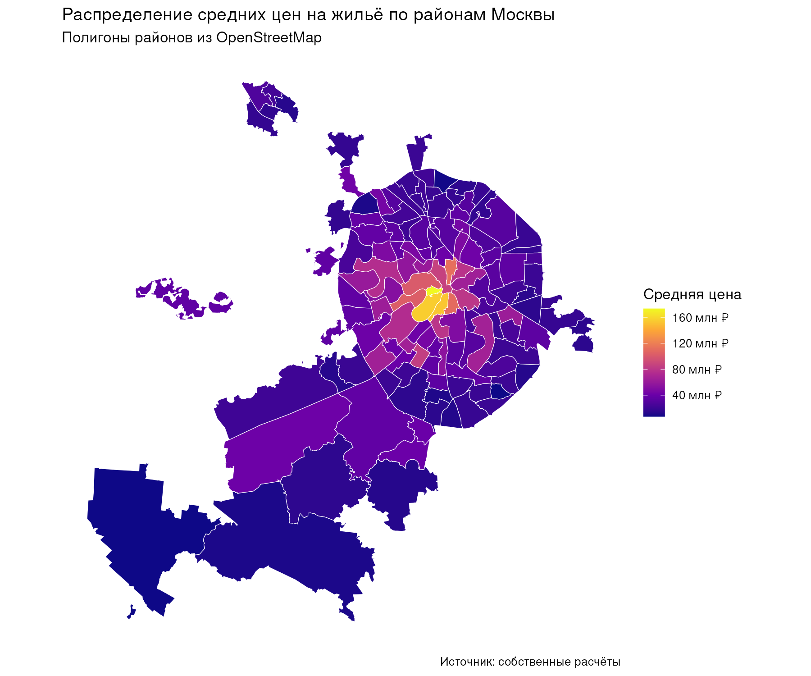
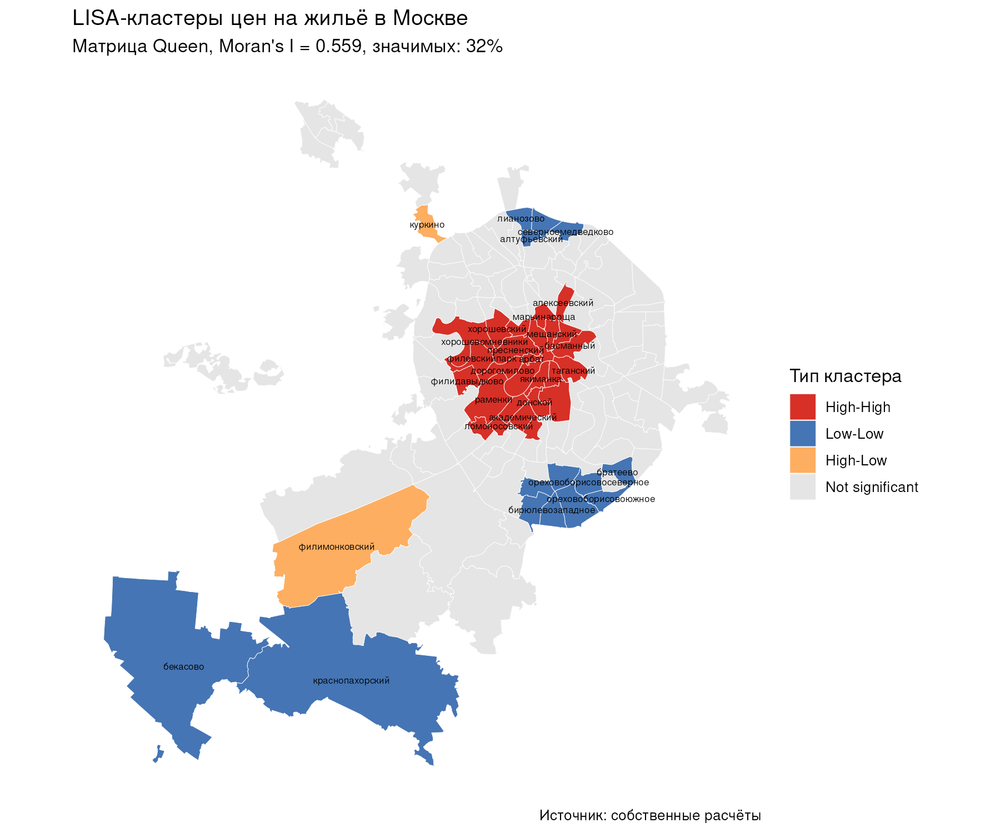
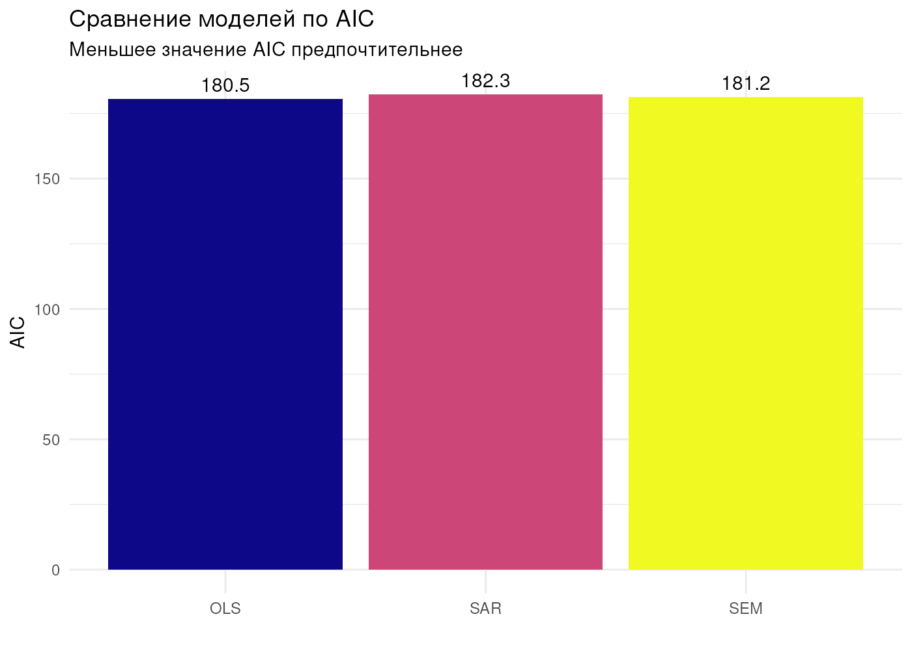
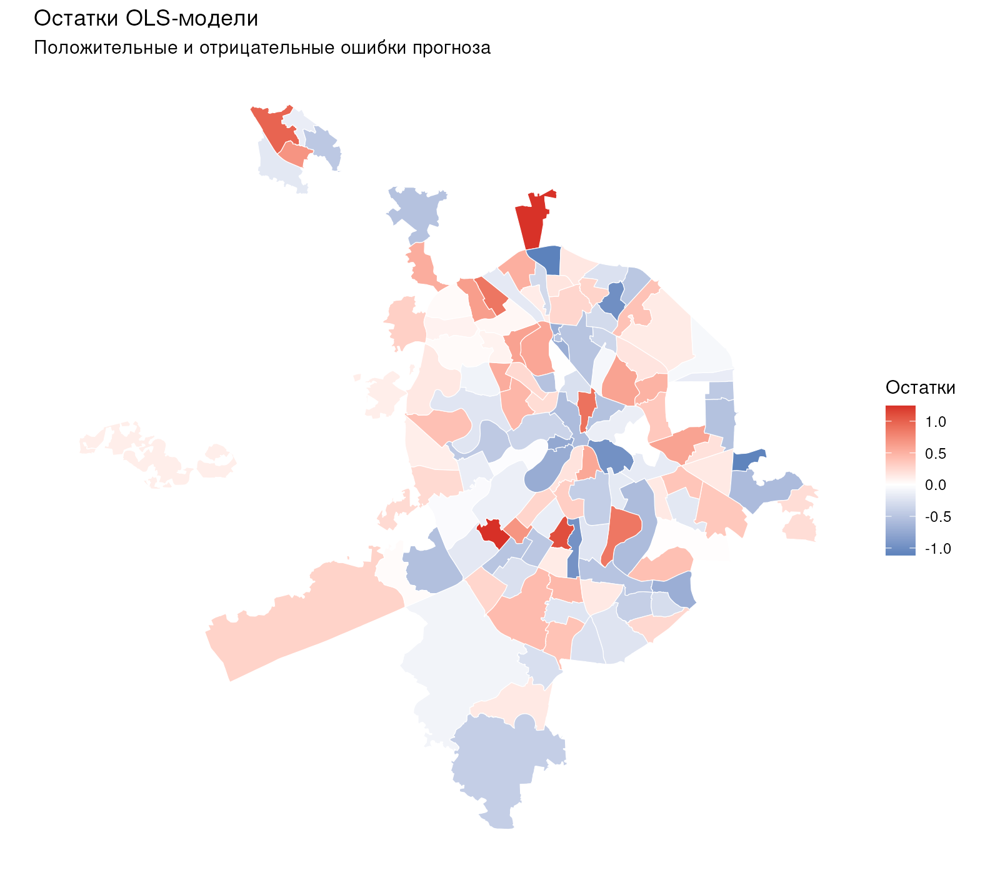
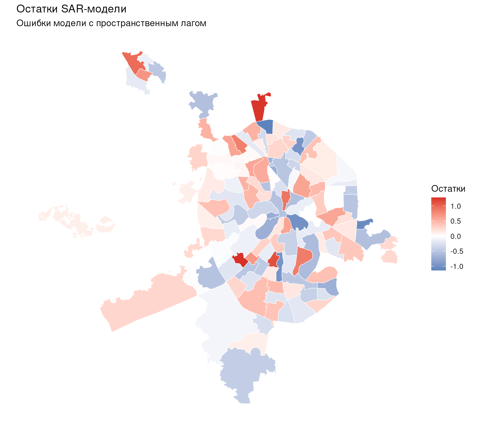
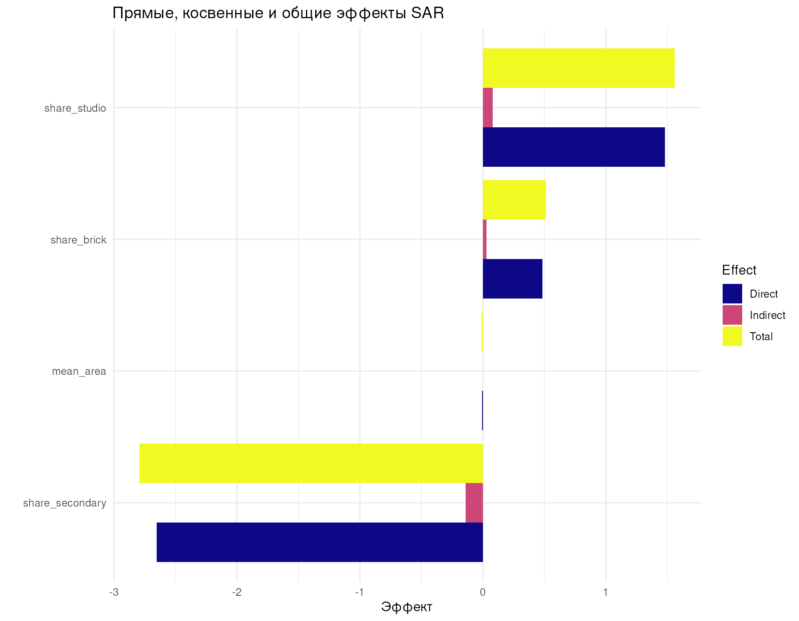

---
output:
  word_document:
    reference_docx: reference.docx
knit: (function(input, ...) { rmarkdown::render(input, output_dir = "output", ...) })
---

```{r setup, include=FALSE}
knitr::opts_chunk$set(echo = TRUE, warning = FALSE, message = FALSE,
                      fig.width = 7.2, fig.height = 5.4,
                      fig.align = "center", cache = FALSE)
library(knitr)
library(dplyr)
library(tidyr)
library(spdep)
library(spatialreg)
library(scales)

res1 <- readRDS("output/task1_results.rds")
res2 <- readRDS("output/task2_results.rds")

fmt_num <- function(x, digits = 3) {
  formatC(x, format = "f", digits = digits)
}
fmt_p <- function(p) {
  ifelse(p < 0.001, "< 0,001", formatC(p, format = "f", digits = 3))
}
```

# ВВЕДЕНИЕ

**Условие.** На основе данных о ценах на жильё и социально-экономических
характеристиках районов Москвы построить и сравнить различные
пространственные эконометрические модели. Необходимо оценить классическую
регрессию OLS с факторами, влияющими на цены жилья, провести диагностику
пространственной зависимости в остатках модели с помощью теста Морана,
выполнить LM-тесты (Lagrange Multiplier) для обоснования выбора между
моделью пространственного лага (SAR) и моделью пространственной ошибки
(SEM), оценить выбранную пространственную модель с использованием функций
`lagsarlm()` и `errorsarlm()` из пакета `spatialreg`, сравнить качество
пространственной модели с OLS-спецификацией по информационным критериям
AIC и BIC, дать содержательную интерпретацию коэффициентов и
сформулировать выводы о значимости различных факторов в формировании цен
на жильё с учётом пространственных эффектов. Перед моделированием
проводится предварительная обработка данных о квартирах и данных о метро.

**Цель работы** — очистить и предобработать исходные данные о
`r formatC(res1$n_realty_raw, format = "d", big.mark = " ")` объявлениях
о продаже квартир и `r formatC(res1$n_metro, format = "d", big.mark = " ")`
выходах станций метро, агрегировать показатели на уровень районов Москвы
и определить, какая эконометрическая спецификация (OLS, SAR или SEM)
корректнее описывает формирование цен на жильё с учётом пространственных
эффектов.

Работа выполнена на языке R в среде RStudio (Docker-образ
`big-data-labs-rstudio`, R 4.6.1) с использованием пакетов `sf`, `spdep`,
`spatialreg`, `geosphere` по методическим указаниям [1]–[4].

# 1 Предварительная обработка данных о квартирах и метро

## 1.1 Исходные данные и первичная очистка

Исходные файлы содержат объявления о продаже жилья в Москве (`DATA.xlsx`)
и справочник выходов метро (`METRO.xlsx`). Каждое объявление описывается
подкатегорией (студии, квартиры), типом рынка, ценой, типом дома,
этажностью, площадью, этажом, санузлом, ремонтом, географическими
координатами и адресом.

Очистка выполнена по правилам п. 6.1 учебного пособия А. В. Замятина [1]:
приведение типов, извлечение числовых значений из текстовых полей,
удаление строк с пропусками в ключевых полях и удаление экстремальных
выбросов по перцентилям.

```{r cleaning-code, eval=FALSE}
df_realty$Цена <- as.numeric(gsub("[^0-9]", "", df_realty$Цена))
df_realty$Общая.площадь <- as.numeric(gsub(" м²", "", df_realty$Общая.площадь))
df_realty$Этаж_номер <- as.numeric(str_extract(df_realty$Этаж, "^\\d+"))
df_realty$Этажей.в.доме <- as.numeric(str_extract(df_realty$Этажей.в.доме, "^\\d+"))

df_realty_clean <- df_realty %>%
  mutate(
    доля_этажа = Этаж_номер / Этажей.в.доме,
    первый_этаж = as.integer(Этаж_номер == 1),
    последний_этаж = as.integer(Этаж_номер == Этажей.в.доме),
    log_price = log(Цена),
    price_per_sqm = Цена / Общая.площадь,
    log_price_sqm = log(price_per_sqm)
  ) %>%
  filter(!is.na(Цена), !is.na(Общая.площадь),
         !is.na(Широта), !is.na(Долгота),
         Общая.площадь > 0, Цена > 0)

# удаление выбросов по 1%- и 99%-перцентилям
q_price <- quantile(df_realty_clean$Цена, c(0.01, 0.99))
q_area  <- quantile(df_realty_clean$Общая.площадь, c(0.01, 0.99))
q_ppsqm <- quantile(df_realty_clean$price_per_sqm, c(0.01, 0.99))
df_realty_clean <- df_realty_clean %>%
  filter(Цена >= q_price[1], Цена <= q_price[2],
         Общая.площадь >= q_area[1], Общая.площадь <= q_area[2],
         price_per_sqm >= q_ppsqm[1], price_per_sqm <= q_ppsqm[2])
```

После базовой очистки (числовые поля, пропуски в цене, площади и
координатах) осталось `r formatC(res1$n_realty_base, format = "d", big.mark = " ")`
объявлений; после расширенной очистки и удаления выбросов —
`r formatC(res1$n_realty_clean, format = "d", big.mark = " ")` объявлений.
Данные о метро содержат `r formatC(res1$n_metro, format = "d", big.mark = " ")`
выходов с координатами без пропусков. Медианная цена предложения после
очистки составляет
`r formatC(median(res1$summary_price[3]), format = "d", big.mark = " ")`
руб., медианная площадь — `r fmt_num(median(res1$summary_area[3]), 1)` м².

## 1.2 Полигоны районов и привязка объектов

Границы районов взяты из GeoJSON-выгрузки OpenStreetMap (`export.geojson`).
Из `r formatC(res1$n_rayons_raw, format = "d", big.mark = " ")` объектов
отобраны только полигоны и мультиполигоны с уровнем
`admin_level = 8` (районы и муниципальные округа): получено
`r res1$n_rayons_clean` уникальных районов. Названия нормализованы
(нижний регистр, удаление слов «район», «поселение», знаков препинания),
по полигонам рассчитаны центроиды.

Каждая квартира привязана к району пространственным соединением
`st_join(..., join = st_within)`; точки вне полигонов (граничные случаи)
привязаны к ближайшему центроиду района:

```{r join-code, eval=FALSE}
df_sf <- df_realty_clean %>%
  st_as_sf(coords = c("Долгота", "Широта"), crs = 4326)
df_joined <- st_join(df_sf, rayons_clean, join = st_within)
```

Для каждого дома рассчитано расстояние по формуле гаверсинусов до
ближайшего выхода метро (`geosphere::distHaversine`), после чего все
показатели агрегированы по районам: средние логарифмы цены и цены за
квадратный метр, средняя площадь и этажность застройки, среднее
расстояние до метро, а также доли квартир с различными характеристиками
(студии, вторичный рынок, кирпичные и панельные дома, евроремонт и
дизайнерский ремонт, совмещённый санузел, первые и последние этажи,
повышенная и высотная застройка). В анализ включены районы не менее чем
с 10 объявлениями: `r res1$n_rayons_model` районов.

```{r dist-code, eval=FALSE}
find_nearest_metro_idx <- function(lon, lat, metro_coords) {
  d <- geosphere::distHaversine(c(lon, lat), metro_coords)
  which.min(d)
}
```

Медианное расстояние до ближайшего выхода метро по всей выборке —
`r fmt_num(median(res1$dist_metro_summary[3]), 2)` км, максимальное —
`r fmt_num(max(res1$dist_metro_summary[6]), 2)` км: транспортная
доступность варьирует между районами почти на порядок, что делает её
кандидатом в предикторы цены.

## 1.3 Мультиколлинеарность факторов

Перед оцениванием регрессии рассчитаны факторные инфляционные
дисперсии (VIF) для исходного набора из 17 предикторов (таблица 1).

:::: {custom-style="Table Caption"}
Таблица 1 — Наибольшие значения VIF исходного набора предикторов
:::

```{r vif-table, echo=FALSE}
vif_top <- sort(res1$vif_values, decreasing = TRUE)[1:8]
vif_tbl <- data.frame(
  Предиктор = names(vif_top),
  VIF = fmt_num(vif_top, 2)
)
kable(vif_tbl, row.names = FALSE)
```

Максимум — `r fmt_num(max(res1$vif_values), 2)` у предиктора
«`r names(which.max(res1$vif_values))`»: он превышает порог 10 и
исключается из набора, остальные
`r sum(res1$vif_values < 10)` предикторов входят в регрессию без риска
мультиколлинеарности [2, с. 76–85].

# 2 Диагностика пространственной зависимости

## 2.1 Матрицы пространственных весов

Построены две матрицы весов, кодирующие соседство районов [4, с. 61–74]:
k-ближайших соседей (k = 8) по центроидам и матрица «ферзь» (Queen) по
фактическому касанию полигонов. Обе стандартизованы по строкам
(style = "W").

```{r w-code, eval=FALSE}
W_knn       <- knn2nb(knearneigh(coords, k = 8))
W_knn_listw <- nb2listw(W_knn, style = "W", zero.policy = TRUE)
W_queen     <- poly2nb(rayon_sf_wgs, queen = TRUE)
W_queen_listw <- nb2listw(W_queen, style = "W", zero.policy = TRUE)
```

Среднее число соседей в матрице k-NN — `r fmt_num(res1$knn_neighbors, 1)`,
в матрице Queen — `r fmt_num(res1$queen_neighbors, 1)`;
изолированных районов нет, обе матрицы пригодны для тестирования.

## 2.2 Глобальный и локальный индексы Морана

Глобальный индекс Морана рассчитан для логарифма средней цены по районам
при обеих матрицах весов.

```{r moran-code, eval=FALSE}
moran_knn   <- moran.test(rayon_sf_wgs$log_price, W_knn_listw,
                          zero.policy = TRUE)
moran_queen <- moran.test(rayon_sf_wgs$log_price, W_queen_listw,
                          zero.policy = TRUE)
```

**Гипотезы.** H₀ — пространственная автокорреляция отсутствует
(I = 0); H₁ — автокорреляция положительная (I > 0).

По матрице k-NN индекс Морана I = `r fmt_num(res1$moran_knn$estimate[1])`
(p `r fmt_p(res1$moran_knn$p.value)`), по матрице Queen —
I = `r fmt_num(res1$moran_queen$estimate[1])`
(p `r fmt_p(res1$moran_queen$p.value)`). Оба теста отвергают H₀ на
уровне значимости 0,05: дорогие районы граничат с дорогими, дешёвые —
с дешёвыми, то есть цены на жильё в Москве пространственно
автокоррелированы. Дальнейшая диагностика опирается на матрицу Queen,
поскольку она отражает фактическое соседство полигонов районов.

Локальный индекс Морана (LISA) выделяет статистически значимые кластеры
(p < 0,1): значимы `r round(100 * res1$lisa_share_sig, 1)`% районов.
Распределение кластеров: High-High —
`r res1$lisa_table[["High-High"]]`, Low-Low —
`r res1$lisa_table[["Low-Low"]]`, High-Low —
`r res1$lisa_table[["High-Low"]]`, Low-High —
`r res1$lisa_table[["Low-High"]]`, незначимые —
`r res1$lisa_table[["Not significant"]]`.

Распределение средних цен по районам показано на рисунке 1, карта
LISA-кластеров — на рисунке 2.

```{r price-map, echo=FALSE, out.width="92%", fig.cap="Рисунок 1 — Средняя цена предложения жилья по районам Москвы"}

```

```{r lisa-map, echo=FALSE, out.width="92%", fig.cap="Рисунок 2 — LISA-кластеры логарифма средней цены (матрица Queen)"}

```

Кластер High-High (ядро дорогого жилья) сосредоточен в центре города,
кластер Low-Low — на периферии. Полученная карта подтверждает вывод
глобального теста и служит наглядным обоснованием перехода от OLS к
пространственным моделям.

# 3 Эконометрические модели цен на жильё

## 3.1 OLS-регрессия и отбор факторов

Зависимая переменная — средний по району логарифм цены; объясняющие —
среднее расстояние до метро, средняя площадь, средняя этажность
застройки, доли квартир с разными характеристиками и объём выборки.
Оценена полная OLS-модель, затем выполнен пошаговый отбор переменных
методом `step(direction = "both")` по критерию AIC [2, с. 70–144].

```{r ols-code, eval=FALSE}
ols_full <- lm(ols_formula_full, data = rayon_reg_wgs)
ols_step <- step(ols_full, direction = "both", trace = FALSE)
```

После отбора в модели осталось
`r length(coef(res2$ols_step)) - 1` объясняющих переменных
(`r paste(names(coef(res2$ols_step))[-1], collapse = ", ")`) и свободный
член. Коэффициент детерминации R² = `r fmt_num(res2$ols_r2)`,
скорректированный R² = `r fmt_num(res2$ols_adj_r2)`: всего три-четыре
агрегированные характеристики района объясняют
`r round(100 * res2$ols_r2)`% вариации логарифма средней цены
(`r res2$n_rayons_final` районов с полными данными). Наибольший вклад
даёт доля вторичного жилья: рост доли на 10 процентных пунктов снижает
логарифм средней цены района примерно на
`r fmt_num(abs(coef(res2$ols_step)["share_secondary"]) * 0.1, 2)`
(то есть среднюю цену — примерно на
`r round((1 - exp(-abs(coef(res2$ols_step)["share_secondary"]) * 0.1)) * 100)`%):
новостройки систематически дороже. Положительный коэффициент при доле
студий отражает центральную локализацию малогабаритного жилья, а
отрицательный при средней площади — сдвиг структуры предложения в
дорогих районах в сторону компактных квартир.

## 3.2 Диагностика остатков: тест Морана и LM-тесты

Остатки OLS-модели проверены на пространственную автокорреляцию тестом
Морана (`lm.morantest`) при матрице Queen.

**Гипотезы.** H₀ — автокорреляция в остатках отсутствует; H₁ —
автокорреляция в остатках присутствует.

```{r moran-ols-code, eval=FALSE}
moran_ols_full <- lm.morantest(ols_step, W_queen_reg_listw,
                               zero.policy = TRUE)
lm_tests_full  <- lm.RStests(ols_step, listw = W_queen_reg_listw,
                             test = "all", zero.policy = TRUE)
```

Статистика Морана для остатков I = `r fmt_num(res2$moran_ols$estimate[1])`
(p `r fmt_p(res2$moran_ols$p.value)`) — H₀ не отвергается: после учёта
социально-экономических характеристик районов пространственная
автокорреляция в остатках не обнаружена. Наблюдаемая выше
автокорреляция цен (I = `r fmt_num(res1$moran_queen$estimate[1])`)
объясняется пространственной кластеризацией самих факторов —
распределением вторичного жилья, студий и транспортной доступности,
а не неучтённым пространственным взаимодействием. Тем не менее вывод
проверяется формальными LM-тестами [4, с. 87–114] (таблица 2).

:::: {custom-style="Table Caption"}
Таблица 2 — LM-тесты пространственной зависимости для OLS-модели
:::

```{r lm-tests-table, echo=FALSE}
lm_tbl <- res2$lm_tests_df
lm_tbl$Statistic <- fmt_num(lm_tbl$Statistic, 3)
lm_tbl$p_value   <- fmt_p(lm_tbl$p_value)
names(lm_tbl) <- c("Тест", "Статистика", "p-значение")
kable(lm_tbl, row.names = FALSE)
```

**Интерпретация.** Обычный LM-тест на пространственный лаг (LMlag)
даёт статистику `r fmt_num(res2$lm_tests_df$Statistic[1])`
(p `r fmt_p(res2$lm_tests_df$p_value[1])`), LM-тест на
пространственную ошибку (LMerr) —
`r fmt_num(res2$lm_tests_df$Statistic[2])`
(p `r fmt_p(res2$lm_tests_df$p_value[2])`): оба незначимы на уровне
0,05. Устойчивые (robust) версии уточняют диагноз: RLMlag —
`r fmt_num(res2$lm_tests_df$Statistic[3])`
(p `r fmt_p(res2$lm_tests_df$p_value[3])`), RLMerr —
`r fmt_num(res2$lm_tests_df$Statistic[4])`
(p `r fmt_p(res2$lm_tests_df$p_value[4])`). По процедуре
Анселина—Бера при обоих незначимых обычных тестах на уровне 0,05
остаётся классическая OLS-спецификация; лишь на уровне 0,10
устойчивый RLMlag даёт слабый сигнал в пользу SAR, который ниже
проверяется формально оценкой обеих пространственных моделей.

**Вывод.** Формальная диагностика не требует пространственной
спецификации: автокорреляция цен целиком объяснена ковариатами.
По требованию задания обе пространственные модели (SAR и SEM) всё же
оцениваются, а финальный выбор делается по информационным критериям
AIC и BIC.

## 3.3 SAR- и SEM-модели, сравнение по AIC и BIC

Модель пространственного лага SAR включает в правую часть лаг
зависимой переменной W·y, модель пространственной ошибки SEM —
авторегрессию в ошибке. Обе оценены методом максимального правдоподобия
(`method = "eigen"`) при матрице Queen.

```{r sar-code, eval=FALSE}
sar_full <- lagsarlm(final_formula, data = rayon_reg_wgs,
                     listw = W_queen_reg_listw,
                     method = "eigen", zero.policy = TRUE)
sem_full <- errorsarlm(final_formula, data = rayon_reg_wgs,
                       listw = W_queen_reg_listw,
                       method = "eigen", zero.policy = TRUE)
```

Параметр пространственной автокорреляции SAR ρ = `r fmt_num(res2$sar_rho)`
(p `r fmt_p(res2$sar_rho_p)`) статистически не отличается от нуля;
параметр SEM λ = `r fmt_num(res2$sem_lambda)`
(p `r fmt_p(res2$sem_lambda_p)`) также незначим. Сравнение моделей по
информационным критериям приведено в таблице 3 и на рисунке 3.

:::: {custom-style="Table Caption"}
Таблица 3 — Сравнение качества моделей OLS, SAR и SEM
:::

```{r comparison-table, echo=FALSE}
cmp <- res2$model_comparison
cmp$LogLik <- fmt_num(cmp$LogLik, 2)
cmp$AIC <- fmt_num(cmp$AIC, 2)
cmp$BIC <- fmt_num(cmp$BIC, 2)
names(cmp) <- c("Модель", "Логарифм правдоподобия", "AIC", "BIC")
kable(cmp, row.names = FALSE)
```

```{r aic-plot, echo=FALSE, out.width="78%", fig.cap=paste0("Рисунок 3 — Сравнение моделей по AIC (лучшая — ", res2$best_model_name, ")")}

```

**Вывод.** Минимальные AIC и BIC у модели
`r res2$best_model_name` (AIC = `r fmt_num(min(res2$model_comparison$AIC))`,
BIC = `r fmt_num(min(res2$model_comparison$BIC))`).
`r ifelse(res2$best_model_name == "OLS", paste0("Пространственные спецификации проигрывают классической OLS-регрессии: прирост логарифма правдоподобия (", fmt_num(res2$model_comparison$LogLik[2] - res2$model_comparison$LogLik[1]), "–", fmt_num(res2$model_comparison$LogLik[3] - res2$model_comparison$LogLik[1]), ") меньше штрафа за дополнительный параметр. Добавление пространственного лага или пространственной ошибки не улучшает модель: зависимость цен объяснена наблюдаемыми факторами районов."), paste0("Пространственная спецификация описывает данные лучше классической OLS-регрессии (AIC OLS = ", fmt_num(res2$model_comparison$AIC[1]), ")."))`
Карты остатков (рисунки 4–6) подтверждают вывод теста Морана: у
OLS-модели нет систематической «пятнистости» ошибок, картина остатков
практически не меняется при переходе к SAR и SEM.

```{r resid-ols, echo=FALSE, out.width="70%", fig.cap="Рисунок 4 — Остатки OLS-модели по районам Москвы"}

```

```{r resid-sar, echo=FALSE, out.width="70%", fig.cap="Рисунок 5 — Остатки SAR-модели по районам Москвы"}

```

```{r resid-sem, echo=FALSE, out.width="70%", fig.cap="Рисунок 6 — Остатки SEM-модели по районам Москвы"}

```

## 3.4 Прямые и косвенные эффекты SAR

В SAR-модели коэффициенты не совпадают с предельными эффектами из-за
одновременности: изменение фактора в одном районе влияет на цены в нём
(прямой эффект) и через лаг W·y — на цены соседних районов (косвенный
эффект). Эффекты разложены функцией `impacts()` с симуляциями Монте-Карло
(R = 1000) [4, с. 87–114]; результаты для значимых факторов — в
таблице 4, полное разложение — на рисунке 7.

:::: {custom-style="Table Caption"}
Таблица 4 — Прямые, косвенные и общие эффекты SAR-модели
:::

```{r impacts-table, echo=FALSE}
imp <- res2$impacts_table
imp$Direct    <- fmt_num(imp$Direct)
imp$Indirect <- fmt_num(imp$Indirect)
imp$Total    <- fmt_num(imp$Total)
names(imp)[1:4] <- c("Переменная", "Прямой", "Косвенный", "Общий")
kable(imp[, 1:4], row.names = FALSE)
```

```{r impacts-plot, echo=FALSE, out.width="92%", fig.cap="Рисунок 7 — Разложение эффектов SAR-модели по факторам"}

```

Наибольший по модулю общий эффект имеет фактор
«`r res2$impacts_table$Variable[which.max(abs(res2$impacts_table$Total))]`»
(общий эффект `r fmt_num(res2$impacts_table$Total[which.max(abs(res2$impacts_table$Total))])`):
рост доли вторичного жилья на 10 процентных пунктов снижает логарифм
средней цены района в сумме на
`r fmt_num(abs(res2$impacts_table$Total[which.max(abs(res2$impacts_table$Total))]) * 0.1, 2)`
с учётом отклика соседних районов. Косвенные эффекты составляют лишь
`r round(100 * mean(abs(res2$impacts_table$Indirect / res2$impacts_table$Total)), 1)`%
общих — межрайонные переливы практически отсутствуют, что прямо
согласуется с незначимостью ρ: пространственное взаимодействие между
районами после учёта их характеристик не обнаруживается, и оценки OLS
не искажены пропущенным пространственным лагом.

Сводные коэффициенты трёх моделей с уровнями значимости приведены в
таблице 5.

:::: {custom-style="Table Caption"}
Таблица 5 — Сводная таблица коэффициентов моделей OLS, SAR и SEM
:::

```{r coef-table, echo=FALSE}
coefs <- res2$all_coefs %>%
  mutate(Estimate = fmt_num(Estimate),
         p_value = fmt_p(p_value)) %>%
  select(Model, Variable, Estimate, p_value, sig) %>%
  mutate(sig_txt = paste0(p_value, " ", sig)) %>%
  select(Model, Variable, Estimate, sig_txt)
names(coefs) <- c("Модель", "Переменная", "Оценка", "p-значение")
kable(coefs, row.names = FALSE)
```

# ВЫВОДЫ

1. Проведена очистка и предобработка данных: из
`r formatC(res1$n_realty_raw, format = "d", big.mark = " ")` объявлений
после контроля типов, пропусков и удаления выбросов по перцентилям
сохранено
`r formatC(res1$n_realty_clean, format = "d", big.mark = " ")`
(`r round(100 * res1$n_realty_clean / res1$n_realty_raw)`%);
`r formatC(res1$n_metro, format = "d", big.mark = " ")` выходов метро
проверены на пропуски координат. Квартиры привязаны к
`r res1$n_rayons_model` районам Москвы, для каждой рассчитано расстояние
до ближайшей станции; показатели агрегированы на уровень районов,
мультиколлинеарность проконтролирована по VIF.

2. Глобальный индекс Морана для логарифма средней цены составил
`r fmt_num(res1$moran_queen$estimate[1])` при матрице Queen
(p `r fmt_p(res1$moran_queen$p.value)`): цены пространственно
автокоррелированы, LISA выделяет ядро дорогого жилья в центре
(`r res1$lisa_table[["High-High"]]` районов High-High) и пояс дешёвого
на периферии (`r res1$lisa_table[["Low-Low"]]` районов Low-Low).

3. OLS-регрессия с пошаговым отбором (AIC) оставляет
`r length(coef(res2$ols_step)) - 1` фактора и объясняет
`r round(100 * res2$ols_r2)`% вариации логарифма средней цены
(R² = `r fmt_num(res2$ols_r2)`). Ключевой фактор — доля вторичного
жилья (p < 0,001): рост доли на 10 п.п. снижает среднюю цену района
примерно на
`r round((1 - exp(-abs(coef(res2$ols_step)["share_secondary"]) * 0.1)) * 100)`%.
Значимы также средняя площадь (p = 0,013) и доля студий (p < 0,001).

4. Тест Морана на остатки OLS (I = `r fmt_num(res2$moran_ols$estimate[1])`,
p `r fmt_p(res2$moran_ols$p.value)`) и LM-тесты (LMlag
p `r fmt_p(res2$lm_tests_df$p_value[1])`, LMerr
p `r fmt_p(res2$lm_tests_df$p_value[2])`) не выявляют остаточной
пространственной зависимости: автокорреляция цен полностью объяснена
пространственной кластеризацией наблюдаемых характеристик районов
(вторичное жильё, студии, доступность метро), а не неучтённым
пространственным взаимодействием.

5. Оценены SAR (ρ = `r fmt_num(res2$sar_rho)`,
p `r fmt_p(res2$sar_rho_p)`) и SEM (λ = `r fmt_num(res2$sem_lambda)`,
p `r fmt_p(res2$sem_lambda_p)`): параметры пространственной
автокорреляции незначимы. По минимуму AIC и BIC лучшей признана модель
`r res2$best_model_name` (AIC = `r fmt_num(min(res2$model_comparison$AIC))`,
BIC = `r fmt_num(min(res2$model_comparison$BIC))`); косвенные эффекты в
SAR составляют лишь
`r round(100 * mean(abs(res2$impacts_table$Indirect / res2$impacts_table$Total)), 1)`%
общих. Для описания цен на жильё Москвы на уровне районов достаточна
классическая OLS-спецификация; значимость факторов (структура рынка и
типаж жилья) следует интерпретировать без поправки на пространственные
переливы, поскольку последние статистически не обнаружены.

# СПИСОК ИСПОЛЬЗОВАННЫХ ИСТОЧНИКОВ

**Литература основная**

1. Замятин, А. В. Интеллектуальный анализ данных: учебное пособие / А. В. Замятин. — Томск: Издательский Дом Томского государственного университета, 2020. — 194 с. — ISBN 978-5-94621-898-6. — Текст: электронный // Образовательная платформа IPR СМАРТ: [сайт]. — URL: https://www.iprbookshop.ru/books/116889/details (дата обращения: 13.11.2026).

**Литература дополнительная**

2. Мастицкий, С. Э. Статистический анализ и визуализация данных с помощью R: учебное пособие / С. Э. Мастицкий, В. К. Шитиков. — М.: ДМК Пресс, 2015. — 496 с. — Текст: электронный. — URL: https://batrachos.com/sites/default/files/pictures/Books/Masticzkij_Shitikov_2015_Statistical_analysis_and_visualization_of_data_us%D1%96ng_R.pdf (дата обращения: 13.11.2026).

3. Лепило, Н. Н. Анализ данных на языке R: учебное пособие / Н. Н. Лепило, И. С. Козлова. — Алчевск: Донбасский государственный технический институт, 2024. — 181 с. — Текст: электронный // Образовательная платформа IPR СМАРТ: [сайт]. — URL: https://www.iprbookshop.ru/books/151541/details (дата обращения: 13.11.2026).

**Интернет-источники**

4. Кадочникова, Е. И. Статистический анализ пространственных данных: учебное пособие / Е. И. Кадочникова, Ю. А. Варламова. — Казань: Издательство Казанского университета, 2023. — 140 с. — Текст: электронный. — URL: https://kpfu.ru/staff_files/F_69581765/Kadochnikova_Varlamova_SAPD_2023.pdf (дата обращения: 13.11.2026).
