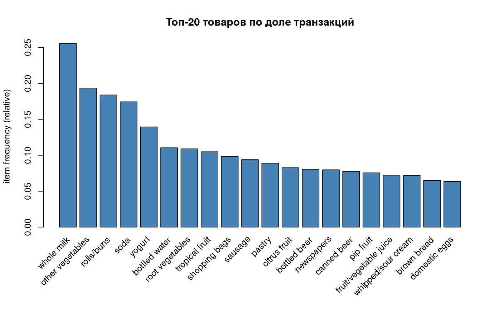
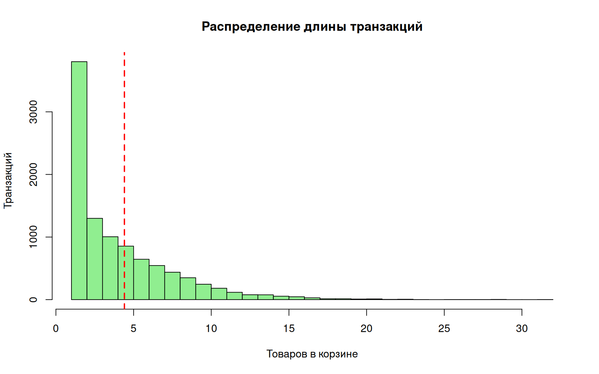
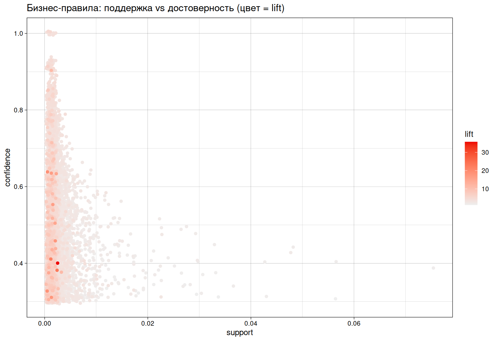
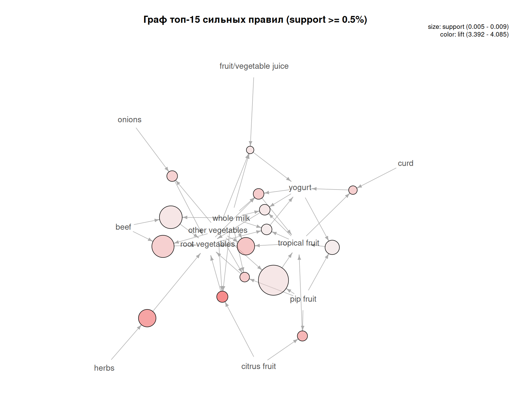

---
output:
  word_document:
    reference_docx: reference.docx
knit: (function(input, ...) { rmarkdown::render(input, output_dir = "output", ...) })
---

```{r setup, include=FALSE}
knitr::opts_chunk$set(echo = TRUE, warning = FALSE, message = FALSE,
                      fig.width = 7.2, fig.height = 5,
                      fig.align = "center", cache = FALSE)
library(knitr)
library(dplyr)

s <- readRDS("output/task1_summary.rds")
strong_df   <- read.csv("output/Groceries_results/strong_rules.csv")
business_df <- read.csv("output/Groceries_results/business_rules.csv")
freq_df     <- read.csv("output/Groceries_results/item_frequencies.csv")

# CSV от arules содержит одну колонку rules "{LHS} => {RHS}":
# выделяем стороны правила в отдельные колонки.
parse_rules <- function(df) {
  df$LHS <- trimws(sub("\\s*=>.*$", "", df$rules))
  df$RHS <- trimws(sub("^.*=>\\s*", "", df$rules))
  df
}
strong_df   <- parse_rules(strong_df)
business_df <- parse_rules(business_df)

# опорные правила, на которые ссылается текст (в CSV arules элементы
# внутри правила перечислены без пробела после запятой — нормализуем)
rule_row <- function(df, lhs, rhs) {
  norm <- function(x) gsub(",\\s+", ",", x)
  df[norm(df$LHS) == norm(lhs) & norm(df$RHS) == norm(rhs), ][1, ]
}
rr_rootveg  <- rule_row(strong_df,
  "{citrus fruit, other vegetables, whole milk}", "{root vegetables}")
rr_butter   <- rule_row(strong_df, "{butter, whipped/sour cream}", "{whole milk}")
rr_sausage  <- rule_row(strong_df, "{rolls/buns, shopping bags}", "{sausage}")
rr_meat     <- rule_row(business_df, "{meat}", "{whole milk}")
rr_frankfur <- rule_row(strong_df, "{frankfurter, yogurt}", "{whole milk}")
rr_saus_mlk <- rule_row(strong_df, "{sausage, whipped/sour cream}", "{whole milk}")

fmt_num <- function(x, digits = 2) {
  formatC(x, format = "f", digits = digits)
}

fmt_rule <- function(df, n, digits = 3) {
  x <- head(df, n)
  data.frame(
    "Правило"     = paste0(gsub("\\{|\\}", "", x$LHS), " → ",
                           gsub("\\{|\\}", "", x$RHS)),
    "Поддержка"   = sprintf("%.3f", x$support),
    "Достоверность" = sprintf("%.3f", x$confidence),
    "Подъём"      = sprintf("%.2f", x$lift),
    check.names = FALSE, stringsAsFactors = FALSE
  )
}
```

# ВВЕДЕНИЕ

**Условие.** Запустить предоставленный R-скрипт, который строит ассоциативные
правила для датасета Groceries (9835 транзакций, 169 товаров): алгоритм Apriori
с параметрами support = 0,001 и confidence = 0,3, удаление избыточных правил,
выделение бизнес-правил (lift > 1,2) и сильных (support ≥ 0,5%, lift > 2),
визуализации, функция рекомендаций с прямым и обратным выводом,
автоматическое формирование бизнес-рекомендаций по категориям (завтрак,
выпечка, алкоголь, снеки, быстрый ужин, фрукты-овощи) и обратный вывод для
молока. В отчёте объяснить смысл метрик support, confidence и lift на
конкретных примерах, разобрать, почему для одних категорий правила найдены,
а для других нет, объяснить разницу прямого и обратного вывода, предложить
практические бизнес-рекомендации и описать ограничения анализа.

**Цель работы** — выявить устойчивые связи между товарами в покупательских
корзинах сетевого магазина и превратить их в управленческие решения:
выкладку, комплектацию наборов и ценовые акценты.

Работа выполнена на языке R в среде RStudio (Docker-образ
`big-data-labs-rstudio`) с использованием пакетов `arules` и `arulesViz`
по методическому скрипту преподавателя.

# 1 Данные и ассоциативные правила

Датасет Groceries входит в пакет `arules` и содержит реальные чеки
продуктового магазина за месяц: `r formatC(s$n_transactions, big.mark = " ")`
транзакций и `r s$n_items` уникальных товаров (транзакция — одна
покупательская корзина, состав известен без количества). Средняя длина
корзины — `r fmt_num(s$mean_basket, 2)` товара. Самые частые товары —
товары-магниты (рисунок 1): `whole milk` присутствует в
`r sprintf("%.1f%%", s$top_anchors[["whole milk"]] * 100)` корзин,
`other vegetables` — в `r sprintf("%.1f%%", s$top_anchors[["other vegetables"]] * 100)`,
`rolls/buns` — в `r sprintf("%.1f%%", s$top_anchors[["rolls/buns"]] * 100)`.

```{r fig-freq, echo=FALSE, out.width="90%", fig.cap="Рисунок 1 — Топ-20 товаров по доле транзакций"}

```

Распределение длины транзакций (рисунок 2) скошено вправо: основная масса
чеков — 1–5 товаров, длинные корзины редки. Поэтому в параметрах Apriori
ограничена длина правил: `minlen = 2`, `maxlen = 4` — правила из 5+
товаров опирались бы на единичные чеки.

```{r fig-hist, echo=FALSE, out.width="90%", fig.cap="Рисунок 2 — Распределение длины транзакций (красная линия — среднее)"}

```

Правило ассоциации X → Y («если в корзине есть набор X, то в ней же
присутствует Y») характеризуют три метрики: **support** (поддержка)
supp(X → Y) = P(X ∪ Y) — доля транзакций, содержащих и X, и Y;
**confidence** (достоверность) conf(X → Y) = supp(X → Y)/supp(X) —
условная вероятность Y при наличии X; **lift** (подъём)
lift(X → Y) = conf(X → Y)/supp(Y) — во сколько раз условная вероятность
Y превышает безусловную (lift > 1 — вместе покупают чаще независимости,
lift = 1 — независимы). На примере датасета: правило
{citrus fruit, other vegetables, whole milk} → {root vegetables} имеет
lift `r fmt_num(rr_rootveg$lift, 1)` — корнеплоды попадают в корзину с
цитрусами, овощами и молоком в несколько раз чаще случайного;
confidence `r sprintf("%.0f%%", 100 * rr_rootveg$confidence)` означает,
что среди корзин с цитрусами, овощами и молоком примерно в каждой
`r fmt_num(1 / rr_rootveg$confidence, 0)`-й лежат и корнеплоды; но
поддержка — лишь `r sprintf("%.2f%%", 100 * rr_rootveg$support)` корзин.

## 1.1 Построение правил и удаление избыточных

Apriori запускался с широкой сеткой (support = 0,001; confidence = 0,3),
чтобы не потерять редкие, но ценные связи.

```{r apriori-code, eval=FALSE}
rules <- apriori(Groceries,
                 parameter = list(support = 0.001, confidence = 0.3,
                                  minlen = 2, maxlen = 4, target = "rules"))

redundant <- is.redundant(sort(rules, by = "lift", decreasing = TRUE),
                          measure = "confidence")
rules_pruned <- sort(rules, by = "lift", decreasing = TRUE)[!redundant]
```

:::: {custom-style="Table Caption"}
Таблица 1 — Воронка отбора правил
:::

```{r funnel-table, echo=FALSE}
data.frame(
  Этап = c("Найдено Apriori", "Избыточные правила", "После очистки",
           "Бизнес-правила (lift > 1,2)",
           "Сильные правила (support ≥ 0,5%, lift > 2)"),
  Количество = formatC(c(s$n_rules, s$n_redundant, s$n_rules_pruned,
                         s$n_business, s$n_strong), big.mark = " "),
  stringsAsFactors = FALSE
) %>% kable(row.names = FALSE)
```

Правило избыто, если существует более общее правило с тем же RHS и не
меньшей достоверностью: например, если {A, B} → C и {A} → C имеют одну
confidence, то условие B ничего не добавляет. После очистки остаётся
`r formatC(s$n_rules_pruned, big.mark = " ")` правил (таблица 1) —
каждое несёт самостоятельную информацию. Отметим, что фильтр
бизнес-правил помимо lift > 1,2 требует строго `support > 0,001` и
`confidence > 0,3`, поэтому правила с confidence ровно 30% остаются
за границей бизнес-набора (в сильные правила confidence не фильтруется
по условию задания).

## 1.2 Сильные правила

Сильные правила (support ≥ 0,5% и lift > 2) — пересечение «часто» и
«выразительно»: они опираются минимум на `r ceiling(0.005 * s$n_transactions)`
чеков и поднимают вероятность покупки в два с лишним раза. Топ-5 правил
по lift приведены в таблице 2.

:::: {custom-style="Table Caption"}
Таблица 2 — Топ-5 сильных правил по lift
:::

```{r strong-table, echo=FALSE}
x <- head(strong_df, 5)
data.frame(
  "Правило" = paste0(gsub("\\{|\\}", "", x$LHS), " → ",
                     gsub("\\{|\\}", "", x$RHS)),
  "Supp / Conf / Lift" = sprintf("%.3f / %.3f / %.2f",
                                 x$support, x$confidence, x$lift),
  check.names = FALSE, stringsAsFactors = FALSE
) %>% kable(row.names = FALSE)
```

На диаграмме рассеяния (рисунок 3) каждое правило — точка: по оси X —
support, по оси Y — confidence, цвет — lift. Виден классический
«закон рынка»: с ростом support confidence падает — самые частые правила
связывают товары-магниты и потому имеют lift, близкий к 1, а высокие lift
достигаются на редких сочетаниях.

```{r fig-scatter, echo=FALSE, out.width="95%", fig.cap="Рисунок 3 — Бизнес-правила: поддержка против достоверности (цвет — lift)"}

```

Граф сильных правил (рисунок 4) показывает ядро связей: молоко, овощи,
йогурт и булочки — центральные вершины, к которым стягиваются условия
большинства правил.

```{r fig-graph, echo=FALSE, out.width="95%", fig.cap="Рисунок 4 — Граф топ-15 сильных правил (support ≥ 0,5%)"}

```

**Вывод.** Из `r formatC(s$n_rules, big.mark = " ")` найденных правил
практическую ценность имеют `r formatC(s$n_strong, big.mark = " ")` сильных:
они одновременно статистически надёжны (высокая поддержка) и бизнес-значимы
(lift > 2). Связка {butter, whipped/sour cream} → {whole milk}
(lift `r fmt_num(rr_butter$lift, 1)`)
и {citrus fruit, other vegetables, whole milk} → {root vegetables}
(lift `r fmt_num(rr_rootveg$lift, 1)`) —
характерные представители.

# 2 Система рекомендаций: прямой и обратный вывод

Функция `recommend_for_basket()` ищет правила двух типов для товаров
переданной корзины.

**Прямой вывод** — правила вида «корзина ⊆ LHS»: если товары корзины
содержатся в левой части правила, рекомендуются товары из RHS. Логика:
«кто берёт X, тот берёт и Y».

**Обратный вывод** — правила вида «корзина ⊆ RHS»: товар корзины оказался
в правой части, рекомендуются товары из LHS. Логика обратная: «кто берёт
Y, обычно перед этим взял X». Это не то же самое, что прямой вывод:
ассоциативные правила несимметричны.

Характерный пример — корзина {whole milk, other vegetables}. Применённые
правила функция ранжирует по confidence и возвращает:
`r paste(s$example_baskets[["whole milk, other vegetables"]], collapse = ", ")`
(таблица 3). Первыми срабатывают «зеркальные» правила, где молоко стоит
справа: {tropical fruit, root vegetables, yogurt} → {whole milk}
(confidence
`r sprintf("%.0f%%", 100 * rule_row(strong_df, "{tropical fruit, root vegetables, yogurt}", "{whole milk}")$confidence)`),
{pip fruit, root vegetables, other vegetables} → {whole milk}
(confidence
`r sprintf("%.0f%%", 100 * rule_row(strong_df, "{pip fruit, root vegetables, other vegetables}", "{whole milk}")$confidence)`)
и {butter, whipped/sour cream} → {whole milk} (confidence
`r sprintf("%.0f%%", 100 * rr_butter$confidence)`). Прямого правила
«молоко + овощи → фрукты» в данных нет — рекомендации приходят из LHS
этих правил: это и есть обратный вывод. Асимметрия хорошо видна и на
мясных товарах: правило {meat} → {whole milk} (support
`r sprintf("%.1f%%", 100 * rr_meat$support)`, confidence
`r sprintf("%.0f%%", 100 * rr_meat$confidence)`, lift
`r fmt_num(rr_meat$lift, 2)`) в сильные не входит (lift < 2), но его
сильные «соседи» {sausage, whipped/sour cream} → {whole milk}
(confidence `r sprintf("%.0f%%", 100 * rr_saus_mlk$confidence)`, lift
`r fmt_num(rr_saus_mlk$lift, 2)`) и {frankfurter, yogurt} → {whole milk}
(confidence `r sprintf("%.0f%%", 100 * rr_frankfur$confidence)`, lift
`r fmt_num(rr_frankfur$lift, 2)`) устроены так же: мясное покупают
«вместе с молоком», а не наоборот — направление правила одностороннее.

:::: {custom-style="Table Caption"}
Таблица 3 — Примеры рекомендаций для корзин
:::

```{r baskets-table, echo=FALSE}
bas <- s$example_baskets
data.frame(
  "Корзина" = names(bas),
  "Рекомендации" = vapply(bas, function(x) {
    if (length(x) == 0) "— (правил с support ≥ 0,5% нет)"
    else paste(head(x, 5), collapse = ", ")
  }, character(1)),
  stringsAsFactors = FALSE, check.names = FALSE
) %>% kable(row.names = FALSE)
```

Для корзин {white bread, butter} и {bottled beer, red/blush wine} сильных
правил нет: совместные покупки этих пар реже порога 0,5% — сами по себе
это ценные сигналы о границах метода (см. раздел 4).

Обратный вывод для молока по всем правилам с support ≥ 0,5% показан в
таблице 4: молоко оказывается в корзинах, которые уже «собрались» вокруг
овощей, фруктов и масла — типичный товар-«зеркало».

:::: {custom-style="Table Caption"}
Таблица 4 — Топ-3 правила вида {набор} → {whole milk} (обратный вывод)
:::

```{r milk-table, echo=FALSE}
mil <- strong_df[strong_df$RHS == "{whole milk}", ]
mil <- mil[order(-mil$confidence), ][1:3, ]
data.frame(
  "Что уже лежит в корзине" = gsub("\\{|\\}", "", mil$LHS),
  "Conf." = sprintf("%.2f", mil$confidence),
  "Supp." = sprintf("%.4f", mil$support),
  check.names = FALSE, stringsAsFactors = FALSE
) %>% kable(row.names = FALSE)
```

**Вывод.** Прямой вывод отвечает на вопрос «что ещё положит покупатель с этими
товарами», обратный — «что уже лежало в корзинах, где покупают этот товар».
Для молока как товара-магнита решающим оказывается именно обратный вывод.

# 3 Бизнес-рекомендации по категориям

Автоматический подбор готовых наборов проверял для каждой категории
сильные правила, где в LHS и RHS суммарно встречается не менее двух
товаров категории (таблица 5).

:::: {custom-style="Table Caption"}
Таблица 5 — Сильные правила по категориям
:::

```{r categories-table, echo=FALSE}
cc <- s$category_counts
data.frame(
  Категория = names(cc),
  "Правил найдено" = as.integer(cc),
  "Комментарий" = c("хлеб + масло + молоко + яйца",
                    "нет: мука/сахар/маргарин редко в одном чеке",
                    "нет: пиво/вино покупают отдельно",
                    "нет: снеки — импульсная одиночная покупка",
                    "сосиски + булочки: «хот-дог-эффект»",
                    "овощи, корнеплоды, цитрусы, фрукты"),
  stringsAsFactors = FALSE, check.names = FALSE
) %>% kable(row.names = FALSE)
```

Категории разделились на «рабочие» (Фрукты-овощи —
`r s$category_counts[["Фрукты-овощи"]]` правил, Завтрак —
`r s$category_counts[["Завтрак"]]`, Быстрый ужин —
`r s$category_counts[["Быстрый ужин"]]`) и «пустые» (Выпечка, Алкоголь,
Снеки — 0 правил). Причина — порог support ≥ 0,5%: пары «мука + сахар»,
«пиво + вино» встречаются реже, чем в
`r ceiling(0.005 * s$n_transactions)` чеках из `r formatC(s$n_transactions, big.mark = " ")`.
Это не отсутствие связи, а её недостаточная частота.

На основе найденных правил сформулированы управленческие рекомендации.

1. **Кросс-выкладка.** {citrus fruit, other vegetables, whole milk} →
   {root vegetables} (lift
   `r fmt_num(rr_rootveg$lift, 1)`)
   — сезонные овощи и корнеплоды размещать в одном маршруте с цитрусами;
   {butter, whipped/sour cream} → {whole milk} — молочную группу собирать
   вокруг масла и сливок.
2. **Bundle-акции.** {rolls/buns, shopping bags} → {sausage} — готовые
   наборы «булочки + сосиски», покупаемые с пакетом (lift
   `r fmt_num(rr_sausage$lift, 1)`,
   классический «хот-дог-эффект» на вынос): скидка на набор выше, чем на
   части.
3. **Цена на товары-магниты.** whole milk (`r sprintf("%.1f%%", s$top_anchors[["whole milk"]] * 100)`
   корзин), other vegetables, rolls/buns держат конкурентными: они
   формируют трафик, а маржа набирается сопутствующими товарами из правил.
   Магниты ставить в глубине зала — маршрут до них проходит мимо полок
   с сопутствующими.
4. **Промо-наборы «Завтрак»** (хлеб + масло + молоко/яйца —
   `r s$category_counts[["Завтрак"]]` правил) — готовые корзины выходного
   дня и «пятничный ужин» (овощи + сосиски + булочки).

**Вывод.** Правила конвертируются в четыре типа решений: выкладка,
bundle-наборы, ценовые якоря и тематические промо; наибольший запас —
у категорий «Фрукты-овощи» и «Завтрак».

# 4 Ограничения анализа

**Почему алкоголь и снеки не дали сильных правил.** Алкоголь и снеки —
штучные импульсные позиции: их пары встречаются реже, чем в
`r ceiling(0.005 * s$n_transactions)` чеках из
`r formatC(s$n_transactions, big.mark = " ")`, и порог support ≥ 0,5%
отсекает такие связи как статистически ненадёжные (при частоте ниже ~50
чеков confidence меняется на десятки процентных пунктов от смены пары
дней данных). Это не отсутствие связи, а её недостаточная частота:
сами связи могут быть выраженными, но редкими.

**Зачем удалять избыточные правила.** Избыточное правило — частный случай
более общего ({A, B} → C при том же confidence, что и {A} → C); без
очистки `r formatC(s$n_redundant, big.mark = " ")` правил из
`r formatC(s$n_rules, big.mark = " ")` — дублирующий шум, искажающий
приоритезацию по lift.

**Почему support — ключевая метрика для практики.** Confidence и lift
можно «настроить» на любом сколь угодно редком правиле: пара из 3 чеков
покажет confidence 100% и огромный lift без устойчивости и охвата.
Support — единственная метрика, связывающая правило с реальным потоком
чеков, поэтому бизнес-фильтрация начинается с порога support, и лишь
затем ранжируются confidence и lift.

Наконец, правила фиксируют **совместность покупок, а не причинность**
(ассоциация ≠ причинность): управленческие решения из раздела 4 —
гипотезы для пилотной проверки (A/B-тест выкладки или набора), а не
гарантия роста продаж. Дополнительные ограничения: данные одного месяца
и одного магазина (нет сезонности и географии), отсутствие количества и
цены в чеке, пороги 0,5%/2 — консервативный компромисс охвата и
надёжности.

# ВЫВОДЫ

В датасете Groceries (`r formatC(s$n_transactions, big.mark = " ")` чеков)
алгоритм Apriori нашёл `r formatC(s$n_rules, big.mark = " ")` правил,
из которых после удаления избыточных осталось
`r formatC(s$n_rules_pruned, big.mark = " ")`, бизнес-значимых
(lift > 1,2) — `r formatC(s$n_business, big.mark = " ")`, сильных
(support ≥ 0,5%, lift > 2) — `r formatC(s$n_strong, big.mark = " ")`.

Главные результаты работы таковы. Выявлено ядро товаров-магнитов —
молоко (`r sprintf("%.1f%%", s$top_anchors[["whole milk"]] * 100)`
корзин), овощи, булочки, газировка, йогурт. Найдены устойчивые
межкатегорийные связи с lift до
`r fmt_num(max(strong_df$lift), 1)` — цитрусы+овощи+молоко → корнеплоды,
масло+сливки → молоко, булочки+пакеты → сосиски. Подтверждено, что
рабочие наборы существуют в категориях «Фрукты-овощи»
(`r s$category_counts[["Фрукты-овощи"]]` правил), «Завтрак»
(`r s$category_counts[["Завтрак"]]`), «Быстрый ужин»
(`r s$category_counts[["Быстрый ужин"]]`), а «Выпечка», «Алкоголь» и
«Снеки» правил с support ≥ 0,5% не дают — их совместные покупки слишком
редки. Построена рекомендательная функция с прямым и обратным
выводом: для корзины {молоко, овощи} она предлагает фрукты и масло —
товары из LHS «зеркальных» правил вида {tropical fruit, root vegetables,
yogurt} → {whole milk}, подчёркивая асимметрию ассоциативных правил.

Практическая ценность — готовые решения по выкладке, bundle-наборам,
ценовым якорям и промо-категориям; ограничение — порог support ≥ 0,5%
отсекает редкие, но потенциально прибыльные связи (алкоголь, снеки),
для которых нужен либо больший объём данных, либо пониженный порог.

# ПРИЛОЖЕНИЕ А. Текст R-скрипта анализа

Полный код выполненного скрипта `task1_groceries_apriori.R`
(воспроизводится дословно):

```{r appendix-code, echo=FALSE, results='asis'}
cat("```r\n")
cat(readLines("task1_groceries_apriori.R"), sep = "\n")
cat("\n```")
```
